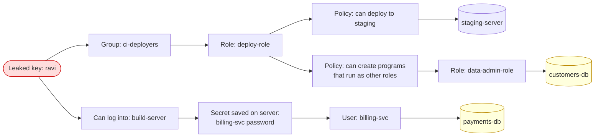

# BreachPath: Problem Statement

**Hackathon:** Graph Hacks: Context for AI Agents (WeMakeDevs × FalkorDB)
**Track:** Track 1, Agents That Act on Connected Data
**Date:** 2026-10-14

---

## 1. Summary

When an attacker steals one login or access key in a company's cloud, nobody can quickly answer two questions:

1. **What sensitive data can the attacker reach from here?** This includes paths that go through many steps, such as user → group → role → policy → database.
2. **What is the smallest permission change that blocks every one of those paths, without breaking the work that real people need to do?**

Today a security engineer answers these by hand. It is slow, paths get missed, and the fixes either remove too much (people get blocked) or too little (the attacker still gets in).

**We want an AI agent that answers both questions correctly.** It should then apply the fix safely, **prove** the fix worked, and explain every step in plain language.

---

## 2. Background: how access works in a company's cloud

In a cloud company (AWS, Azure, GCP), people and programs don't get access directly. Access is spread across many layers:

| Thing | What it is | Example |
|---|---|---|
| **User** | A person or a program with a login or access key | `ravi`, `ci-bot` |
| **Group** | A set of users who share permissions | `developers`, `ci-deployers` |
| **Role** | A set of permissions that a user or a program can "switch into" | `deploy-role`, `data-admin-role` |
| **Policy** | The written rules that say what a role or group may do | "can read `customers-db`" |
| **Server** | A machine people can log into | `build-server` |
| **Database** | Where data lives | `customers-db`, `payments-db` |
| **Secret** | A stored password or key, sometimes saved on a server | `billing-db-password` |

Access is a **chain**. A user is in a group. The group can switch into a role. The role has a policy. The policy allows reading a database. A server can also hold a saved password for another account, which opens a new chain.

A big company has thousands of these links. Many were added years ago, for one-time tasks, and nobody removed them.

---

## 3. The problem

### 3.1 The trigger

An attacker gets one identity. Common ways:

- An access key is pushed by mistake to a public GitHub repo.
- An employee's laptop gets malware.
- A phishing email steals a password.

### 3.2 The three questions nobody can answer fast

| # | Question | Why it is hard |
|---|---|---|
| Q1 | **Blast radius:** what sensitive data ("crown jewels") can this identity reach? | The path can be 4–6 steps long and pass through roles, servers and saved passwords. No single screen shows it. |
| Q2 | **Choke point:** which few permissions, if removed, cut **every** path? | There can be many paths. Removing one path's permission often leaves another path open. |
| Q3 | **Safe fix:** will that change break anyone's real work? | Some permissions on the path are needed for daily work, for example deploying code. Removing them causes an outage. |

### 3.3 What goes wrong today

- **Paths are missed.** People check direct permissions but miss indirect ones, such as "this role can create a program that runs as an admin role."
- **The fix is too big.** The team disables the whole user or group, and real work stops.
- **The fix is too small.** The team removes one permission, but a second path is still open.
- **Nobody checks the fix.** After the change, nobody re-checks that every path is really closed.
- **No explanation.** Managers and auditors can't see *why* a permission was removed.

---

## 4. Example scenario

**Company:** "Acme Retail" (fictional, synthetic data).
**Event:** developer Ravi's access key is found in a public GitHub repo.
**Crown jewels:** `customers-db` (customer personal data) and `payments-db` (payment records).

**What a good answer looks like:**

- **Attack path 1 (4 hops):** `ravi` → `ci-deployers` → `deploy-role` → "create programs that run as other roles" → `data-admin-role` → `customers-db`
- **Attack path 2 (3 hops):** `ravi` → log into `build-server` → saved `billing-svc` password → `payments-db`
- **Business-required access (must keep working):** Ravi must still deploy to `staging-server` and log into `build-server` to run builds.
- **Wrong fix 1:** remove Ravi from `ci-deployers`. This closes path 1 but blocks his deploys, and path 2 stays open.
- **Wrong fix 2:** remove Ravi's login to `build-server`. This closes path 2 but blocks his builds.
- **Right fix (2 changes):**
    1. Remove "create programs that run as other roles" from `deploy-role`'s policy.
    2. Delete the saved `billing-svc` password from `build-server`.
- **Proof:** after the fix there are 0 paths to the crown jewels, and Ravi can still deploy to staging.

The real test data will have several scenarios like this, and some will be harder: more paths, shared choke points, or no safe fix at all.

---

## 5. Who has this problem

| Who | Their pain |
|---|---|
| **Security / incident-response team** | They must contain a leak in minutes, but finding all paths takes hours by hand. |
| **Cloud / platform engineers** | They are afraid to remove permissions because they might break production. |
| **Security managers and auditors** | They need a clear record of what was at risk, what was changed and why. |
| **Small companies with no security team** | They have no tools and no experts to do this at all. |

---

## 6. Why it is hard today

| Approach | Why it fails |
|---|---|
| **Manual review in the cloud console** | It shows one item at a time. People can't follow 5-step chains across thousands of links. |
| **Spreadsheets / permission lists** | A list shows *who has what*, not *how one thing leads to another*. Multi-step paths stay hidden. |
| **SQL / relational database** | Each extra step needs another JOIN, and the number of steps is unknown. Queries get slow and complex. |
| **A plain LLM (ChatGPT-style) reading a JSON dump** | With thousands of links it loses track, misses paths, invents paths that don't exist, and can't prove a fix is minimal. |
| **Existing attack-path tools** | They mostly **show** paths. They don't pick the smallest safe fix, apply it, and prove it worked. |

---

## 7. Why this is a graph problem

This problem is a **graph** by nature: things (nodes) connected by permissions (edges).

| Need | Graph feature that solves it |
|---|---|
| Follow chains of unknown length | Variable-length path queries in Cypher, e.g. `(a)-[*1..6]->(b)` |
| Find the shortest and the most dangerous paths | Shortest-path algorithms (`algo.SPpaths`) |
| Find the permissions many paths pass through | Betweenness centrality (`algo.betweenness`) |
| Find the **fewest** permissions to remove to cut **all** paths | Max-flow / min-cut (`algo.maxFlow`): by math, the max flow equals the size of the smallest cut |
| Never cut business-needed access | Give those edges a very high capacity, so the min-cut avoids them |
| Prove the fix | Run the same path queries again on the changed graph |

**Without the graph database, the product can't work**, which matches hackathon Rule 3. There would be no paths, no min-cut and no proof.

---

## 8. What we want: requirements

The solution must do the following. This section says **what** it must do, not **how**.

### 8.1 Input

1. A company access graph: users, groups, roles, policies, servers, databases, secrets and the links between them.
2. The **compromised identity** (the starting point).
3. The list of **crown jewels** (sensitive targets).
4. The list of **business-required access** for the **whole company**, not just the compromised person: access explicitly declared, plus access each person actually used recently.

### 8.2 What the agent must do

| # | Requirement |
|---|---|
| R1 | **Find every attack path** from the compromised identity to every crown jewel, including indirect, multi-step paths. |
| R2 | **Rank the paths**: shortest first, and show how many paths reach each crown jewel. |
| R3 | **Find choke points**: the permissions that the most paths depend on. |
| R4 | **Compute the smallest fix**: the fewest permission removals that cut **all** attack paths. |
| R5 | **Respect business access**: never remove a business-required permission. If no safe fix exists, say so clearly and suggest an alternative, such as splitting a role into two. |
| R6 | **Act safely**: apply the fix to a **sandbox copy** of the graph, never to the original. |
| R7 | **Verify**: re-check that (a) zero attack paths remain and (b) every business-required access, for everyone, still works. If a check fails, retry only when something can be changed. Otherwise escalate to a human. |
| R8 | **Explain**: give a plain-language report covering each path found, each change made, and the reason for each change. |
| R9 | **Choose its own tools**: the agent decides which graph query or algorithm to run at each step, with tools exposed through MCP. |

### 8.3 Output

- A list of attack paths, shown visually.
- The recommended fix: the list of permissions to remove.
- A verification result: pass/fail for "no paths left" and "business still works."
- A short, human-readable incident report.

---

## 9. Success criteria

We plant the attack paths ourselves, so the correct answer is known and every result can be scored.

| Metric | Target | How we measure |
|---|---|---|
| **Path recall:** real paths found / all planted paths | 100% | Compare with the planted answer key |
| **Path precision:** no fake paths reported | 100% | Every reported path must exist in the graph |
| **Fix size** | Equal to the true minimum | Compare with the min-cut answer key |
| **Business access broken** | 0 | Re-run every business-required path (company-wide) after the fix |
| **Collateral** | As low as possible, and ≤ every baseline | Count other people who lose any access because of the fix |
| **Attack paths left after fix** | 0 | Re-run every attack-path query after the fix |
| **Explanation coverage** | Every change has a path and a reason | Check the report |
| **"No safe fix" case** | Agent says it can't fix safely and suggests an alternative | One planted scenario has no safe fix |
| **Graph vs no graph** | Same LLM with only a JSON dump scores clearly lower | Run both on the same scenarios |

**Test set:** about 5 planted scenarios on a synthetic company of about 150 nodes. At least one scenario has more than one path, one has a shared choke point, and one has no safe fix.

---

## 10. Scope and constraints

- **Track:** Track 1 only, *Agents That Act on Connected Data* (prize: iPhone 18 Pro).
- **Data:** synthetic company data only, generated by our own script (Rule 6). No real cloud accounts and no private data.
- **Database:** FalkorDB is the primary database and does the core work: paths, algorithms and verification (Rules 2 and 3).
- **Timeline:** Oct 15, 12:01 AM IST to Oct 18, 11:59 PM IST. Main coding starts only after the start time (Rule 8).
- **Submission:** public repo, README with the graph model, the Cypher queries and algorithms used, a demo video, and a live deployment or full local setup steps (Rule 10).
- **AI use:** AI help is allowed but must be disclosed, and we must be able to explain the graph model, queries and design (Rules 11–13).

---

## 11. Out of scope

- Connecting to real AWS, Azure or GCP accounts, or changing real permissions.
- Detecting the leak itself. We assume we already know which identity is compromised.
- Network attacks and software bugs (CVEs). We only cover **permission and access paths**.
- Live, real-time monitoring.
- More than one cloud provider at once.

---

## 12. Key terms

| Term | Simple meaning |
|---|---|
| **Identity** | Anything that can log in: a person or a program. |
| **Compromised identity** | An identity the attacker now controls. |
| **Crown jewel** | The most sensitive data or systems, such as customer data or payments. |
| **Attack path** | A chain of links that lets the attacker go from the compromised identity to a crown jewel. |
| **Multi-hop** | A path that goes through several steps, not just one. |
| **Blast radius** | Everything the attacker can reach from the starting point. |
| **Choke point** | A single permission that many attack paths pass through. |
| **Max-flow / min-cut** | A graph algorithm. The min-cut is the smallest set of links that disconnects a start from a target. |
| **Business-required access** | Access real people need for their daily work. It must not break. |
| **Sandbox** | A safe copy of the graph where we test changes before touching anything real. |
| **Least privilege** | The rule that everyone should have only the access they need, nothing more. |
| **Cypher** | The query language used to search graphs in FalkorDB. |
| **MCP** | Model Context Protocol, a standard way to give an AI agent tools it can choose from. |
