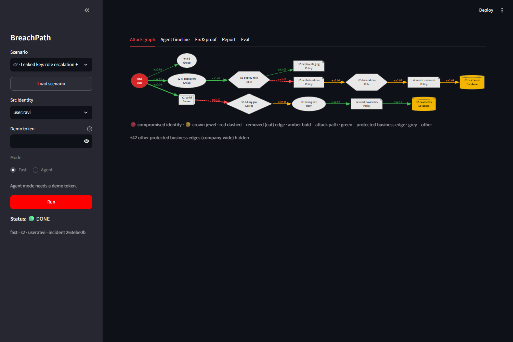
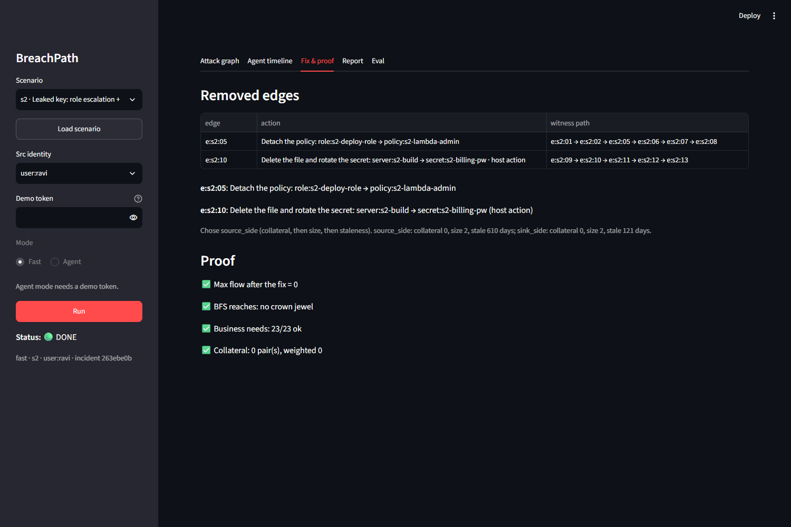
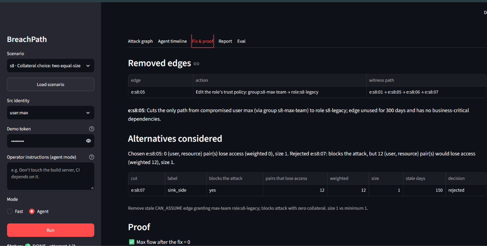
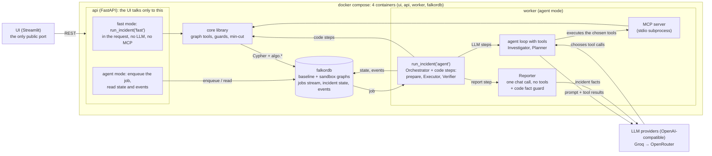
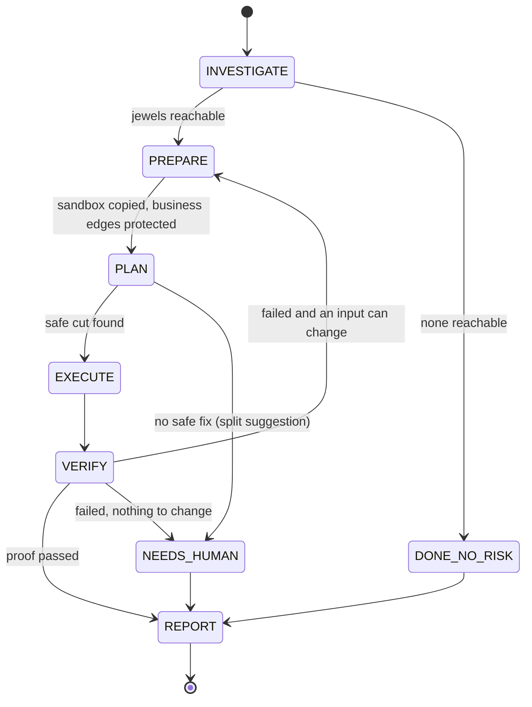
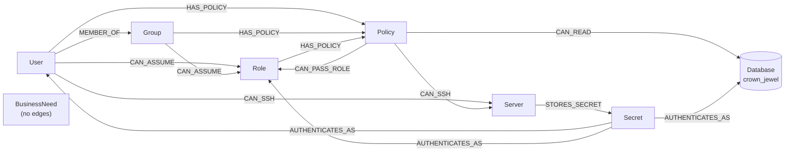

# BreachPath

**An attack-path agent on FalkorDB that fixes the problem and proves the fix.**

**Hackathon:** Graph Hacks: Context for AI Agents (WeMakeDevs × FalkorDB)
**Track:** Track 1, *Agents That Act on Connected Data*

When an access key leaks, BreachPath finds every path from the stolen identity to the company's most sensitive data, computes the **smallest set of permissions to remove** without breaking anyone's real work, applies it to a **sandbox copy** of the graph, **proves** it worked, and explains it in plain language.

## The 30-second story (scenario S2)

Acme Retail (synthetic data). Developer `user:ravi`'s access key is found in a public repo.

1. **Every path.** From `user:ravi` the attacker reaches 2 crown jewels, `db:s2-customers` and `db:s2-payments`, over 2 attack paths:
   - `ravi → group:s2-ci-deployers → role:s2-deploy-role → policy:s2-lambda-admin → role:s2-data-admin → policy:s2-read-customers → db:s2-customers` (a role escalation)
   - `ravi → server:s2-build → secret:s2-billing-pw → user:s2-billing-svc → policy:s2-read-payments → db:s2-payments` (a password saved on a build server)
2. **The smallest safe fix.** `algo.maxFlow` says 2 edges are enough, and business-needed edges are protected so the cut can never use them. Removing Ravi from the group, or his login to the build server, would stop his daily work. The fix instead is:
   - `e:s2:05`: detach `policy:s2-lambda-admin` from `role:s2-deploy-role`
   - `e:s2:10`: delete the saved file and rotate `secret:s2-billing-pw` (a **host action**, not an IAM call)
3. **Applied to a sandbox.** The edges are removed in a `GRAPH.COPY` of the graph, never in the real one.
4. **Proved.** Max flow after the fix is 0, a full BFS reaches no crown jewel, and all 23 business needs still work. Collateral: 0 other people lose access.
5. **Explained.** A report says what was at risk, which edge was removed, why, and what to do next.

## Screenshots

**S2: the attack graph.** The compromised user (red), the two crown jewels (gold), the two cut edges (red dashed), the attack paths (amber) and protected business edges (green).



**S2: the fix and the proof.** Two removed edges with their witness paths, then the four proofs: max flow 0, BFS reaches no jewel, 23/23 needs ok, collateral 0.



**S8: choosing between two equal-size fixes.** Both candidate cuts have size 1. The first has collateral 0, the second would make 12 stale analysts lose access. BreachPath picks `e:s8:05`.



## Architecture



**3 LLM agents (Investigator, Planner, Reporter) + 2 code workers (Executor, Verifier) + an Orchestrator.** The Executor and Verifier are plain code on purpose: the steps that *change* things and *judge* things must be deterministic.

**Two modes.** *Fast mode* runs in the API process with no LLM and no MCP: code brains call `core` directly. *Agent mode* runs in the worker. For the **Investigator and the Planner**, the agent loop sends the prompt and the allow-listed tools to the LLM, the **LLM chooses which tool to call**, the loop executes that call through the MCP server (which only wraps `core`) and returns the result to the LLM, until the agent submits its answer. The **Reporter** uses no tools: one chat call over the incident facts, then the code fact guard checks the text. The MCP server never talks to the LLM itself. The code steps (prepare the sandbox, Executor, Verifier) call `core` directly in both modes.

One pipeline, `core/pipeline.py: run_incident(mode)`, runs both modes. It saves the incident state after every step, so a restarted worker resumes where it stopped.



### Graph guarantees, LLM chooses

- **Code produces and verifies the options.** Paths, the min-cut candidates, the simulation of each cut and the final proof all come from FalkorDB and plain code.
- **The LLM chooses among verified options** (and explains them). The Planner can submit only a cut that `simulate_cut` reported as blocking the attack with every need intact. Anything else is rejected and the code ranking decides.
- **A weak model can make the story worse, never the fix or the proof wrong.** Example, scenario S7: one path is 8 hops long, beyond the 6-hop bound used to *list* paths. The list of paths is therefore empty, but the code BFS (`algo.bfs`, unbounded) and the max-flow still find the jewel and cut it (eval: S7 jewel recall 100%, cut size 1, gap 0). The Investigator takes the reachable jewels from that BFS, not from the LLM. If a model leaves one out, the findings note `LLM missed: <jewel>`. This was observed in a live run on 2026-10-17 (fresh run, LLM cache off, Groq `openai/gpt-oss-120b`, 3 calls): the model listed no jewel (`llm_jewels` empty), the notes said `LLM missed: db:s7-billing`, and the code BFS still reported `db:s7-billing`. One run, not a rate: `tests/test_investigator.py::test_live_s7_beyond_the_hop_bound_has_no_paths`; the mechanism is also unit-tested with a scripted model.
- **No LLM at all is also fine:** with no key, or when the providers are down, every agent step falls back to the code ("degraded mode").

## Graph data model

Each scenario is its own tenant, `s1` … `s8`. Graph names (`core/graph/schema.py`):

| Graph | What | Who writes it |
|---|---|---|
| `t:{scenario}:baseline` | the company graph (background company + one planted scenario) | the loader only |
| `t:{scenario}:sbx:{incident}` | the incident's sandbox (a `GRAPH.COPY` of the baseline) | the Executor, through guarded write tools |
| `t:{scenario}:sbx:{incident}-split`, `…-sim-{n}` | the split proof sandbox and throw-away simulation copies | code, guarded |

Every node has the shared label `:Asset` plus one type label. One index on `Asset.id` finds any node.

| Label | Properties |
|---|---|
| `:Asset:User` | `id`, `name`, `user_type` (human / service), `team` |
| `:Asset:Group` | `id`, `name` |
| `:Asset:Role` | `id`, `name`, `env` |
| `:Asset:Policy` | `id`, `name`, `actions` |
| `:Asset:Server` | `id`, `name`, `env` |
| `:Asset:Database` | `id`, `name`, `env`, `crown_jewel` (bool), `sensitivity` |
| `:Asset:Secret` | `id`, `name`, `secret_type` |
| `:BusinessNeed` | `id`, `principal_id`, `resource_id`, `reason`, `source` (explicit / usage), `valid`. **No edges.** |

**Every edge is stored as one relationship type, `:ATTACK`.** The real meaning is in its property `kind`. Why: `algo.maxFlow` accepts exactly one relationship type. An edge means "if you control FROM, you gain TO". The 8 kinds:

| `kind` | From → To | Fix when cut |
|---|---|---|
| `MEMBER_OF` | User → Group | remove user from group |
| `CAN_ASSUME` | User, Group → Role | edit the role's trust policy |
| `HAS_POLICY` | User, Group, Role → Policy | detach the policy |
| `CAN_READ` | Policy → Database | remove the statement from the policy |
| `CAN_SSH` | User, Policy → Server | revoke the SSH key / access grant |
| `CAN_PASS_ROLE` | Policy → Role | remove PassRole (privilege escalation) |
| `STORES_SECRET` | Server → Secret | delete the file and rotate the secret (**host action**) |
| `AUTHENTICATES_AS` | Secret → User, Role, Database | rotate the credential |

Edge properties: `eid` (stable id, e.g. `e:s2:05`), `kind`, `cap` (max-flow capacity, 1 = removable), `w` (1, weight for shortest paths), `last_used_days` (staleness), `technique` (optional), and in a sandbox `protected` (true on a business-need path) and `needs` (which needs protect it). At most one edge per (src, dst) pair, because `algo.maxFlow` fails on multi-edges.

**Business needs are nodes without edges**, so whole-graph algorithms stay correct. They cover the **whole company**, not only the compromised user: some are written in the scenario, and for every user, each server or database they reach over a path whose edges were all used in the last 30 days becomes a need.



The data is **synthetic** and made by a seeded generator (`data/generator.py`): a background company of 128 nodes and 165 edges (seed 42) plus one planted scenario. The 8 scenario graphs have 133 to 158 asset nodes and 170 to 197 edges (S6, the largest: 158 nodes, 197 edges), plus their business-need nodes (S6: 19). The 8 scenarios have a known answer key (`data/answer_keys/`):

| | Scenario | What it tests |
|---|---|---|
| S1 | simple chain | the basic case |
| S2 | role escalation + a saved password on a build server | two paths, two different fixes, one host action |
| S3 | four paths through one stale role assumption | a shared choke point (1 edge cuts all) |
| S4 | one real path among decoys | precision |
| S5 | the path is made only of business-protected edges | **no safe fix** |
| S6 | a busy hub group is on no attack path | a betweenness trap |
| S7 | an 8-hop path beyond the 6-hop listing bound | completeness |
| S8 | two equal-size cuts, one breaks 12 stale analysts | the collateral choice |

## Scenario file format (bring your own graph)

The UI and the API offer only the 8 built-in scenarios; there is **no upload yet**. A scenario is one YAML file in `data/scenarios/` (see `s2.yaml`); `python -m data.scenarios --all` merges it with the seeded background company and writes `data/generated/<id>.json` plus the answer key. `core/graph/loader.py` loads that JSON into FalkorDB and checks the counts.

| Key | What it holds |
|---|---|
| `id`, `title` | scenario id (`s2`) and a one-line description |
| `src` | the compromised identity, e.g. `user:ravi` |
| `nodes` | `{id, label, name, ...}`; `label` is one of User, Group, Role, Policy, Server, Database, Secret; a Database may set `crown_jewel: true` and `sensitivity` |
| `edges` | `{eid, type, src, dst, last_used_days}`; `type` is one of the 8 kinds (stored as `kind`); optional `technique`; at most one edge per (src, dst) pair |
| `needs` | business needs `{id, principal_id, resource_id, reason, source, valid}`; usage-based needs are added by the generator |
| `expect` (in the JSON) | the answer key: path count, jewels, min-cut size, `safe` |

`cap = 1` and `w = 1` are set by the loader, never written in the file. A scenario with no `crown_jewel: true` database has nothing to attack, so its result is meaningless.

Example, one edge of S2: `{eid: "e:s2:05", type: HAS_POLICY, src: role:s2-deploy-role, dst: policy:s2-lambda-admin, last_used_days: 210}`.

## Code tour (read in this order)

1. `core/graph/schema.py`: graph names, the one edge type, the constants.
2. `core/graph/queries.py`: every Cypher query (`MAX_FLOW`, `ATTACK_PATHS`, `REACH_BFS`, ...).
3. `core/graph/mincut.py`: `algo.maxFlow`, the residual BFS and the cut with its sanity assert.
4. `core/tools/write.py` and `core/tools/guards.py`: sandbox, simulation, apply, and the four write guards.
5. `core/tools/verify.py`: the proof (max flow 0, BFS, needs ok).
6. `core/pipeline.py`: `run_incident`, the one pipeline for both modes. With `orchestrator/state_machine.py`.
7. `agents/base.py`: the agent loop where the LLM chooses tools and MCP runs them. Then `agents/planner.py` and `agents/reporter.py`.
8. `mcp_server/server.py`: the 17 tools.
9. `eval/run_eval.py` and `eval/results/latest.md`: the evaluation.

## Cypher queries and graph algorithms used

All Cypher is in `core/graph/queries.py`, always parameterized. Edge type, hop bounds and BFS depth are constants written into the strings once, never from user input. The 4 indexes are in `core/graph/schema.py`.

| Feature | Where | What it does for BreachPath | A real query |
|---|---|---|---|
| **Variable-length paths** | `queries.ATTACK_PATHS`, `BLAST_RADIUS`, `EDGE_FREQUENCY` | every attack path to a jewel (up to `MAX_HOPS` = 6), shortest first; which edges most paths share | `MATCH p = (s:Asset {id: $src})-[:ATTACK*1..6]->(t:Database {crown_jewel: true}) RETURN t.id, [r IN relationships(p) \| r.eid] AS eids ORDER BY length(p) LIMIT $k` |
| **`algo.maxFlow`** | `queries.MAX_FLOW`, used by `core/graph/mincut.py` | max flow from the compromised identity to all jewels = size of the smallest cut | `CALL algo.maxFlow({sourceNodes: [s], targetNodes: targets, relationshipTypes: ['ATTACK'], capacityProperty: 'cap'}) YIELD edges, edgeFlows, maxFlow` |
| **`algo.bfs`** | `queries.REACH_BFS`, `REACH_SETS` | the **unbounded** check that no jewel is reachable after the fix; what every other user can reach before and after (collateral) | `CALL algo.bfs(s, 50, null) YIELD nodes RETURN [n IN nodes WHERE n:Database AND n.crown_jewel = true \| n.id]` |
| **`algo.SPpaths`** | `queries.NEEDS_CHECK`, `PROTECT_NEEDS`, `SHORTEST_PATHS` | one shortest path per business need is protected; after the fix every need must still have a path | `CALL algo.SPpaths({sourceNode: a, targetNode: b, relTypes: ['ATTACK'], relDirection: 'outgoing', weightProp: 'w', pathCount: 1}) YIELD path` |
| **`algo.betweenness`** | `queries.BETWEENNESS` | a global choke-point hint for the Planner (not the fix) | `CALL algo.betweenness({relationshipTypes: ['ATTACK'], samplingSize: $n, samplingSeed: 42}) YIELD node, score` |
| **`GRAPH.COPY`** | `core/tools/write.py` (`create_sandbox`, `simulate_cut`), `core/tools/split.py` | the incident sandbox, the simulation of each candidate cut and the split proof, all copies of a graph; the baseline is never written | `get_graph(baseline).copy(sandbox)` |
| **`GRAPH.RO_QUERY`** | `core/graph/client.py` (`ro_query`) | every read, and the one free-form agent tool, run read-only with a timeout: the server rejects writes | `get_graph(name).ro_query(cypher, params, timeout=QUERY_TIMEOUT_MS)` |
| **`UNWIND` batch** | `core/graph/loader.py`, `queries.APPLY_FIX`, `EDGE_STATE` | load a scenario in batches of 500; apply a fix to a list of edges in one query | `UNWIND $rows AS row CREATE (n:Asset:User) SET n += row` and `UNWIND $eids AS eid MATCH ()-[r:ATTACK]->() WHERE r.eid = eid AND coalesce(r.protected, false) = false DELETE r` |
| **Relationship index** | `core/graph/schema.py` | edge lookups by `eid` | `CREATE INDEX FOR ()-[r:ATTACK]-() ON (r.eid)` |

### The min-cut idea (`core/graph/mincut.py`)

1. By the max-flow / min-cut theorem, the max flow from the attacker to the jewels equals the size of the smallest set of edges that cuts every path.
2. After `algo.maxFlow`, build the **residual graph** from the edge flows. The nodes the attacker can still reach form set S. Every edge from S to outside S is in a minimum cut (`source_side`). The same from the jewel side gives the second candidate (`sink_side`).
3. **Protected edges.** In the sandbox, every edge on a business need's shortest path gets `cap = PROTECT_CAP` = (edge count + 1). Any cut that includes one costs more than all removable edges together, so if `maxFlow < PROTECT_CAP` the cut contains no protected edge. If `maxFlow ≥ PROTECT_CAP`, there is no safe fix (S5).
4. The residual BFS **crosses** protected edges. Blocking them would break the max-flow = min-cut equality.
5. **Sanity assert:** the capacities of each candidate cut must add up to the max flow, otherwise `MinCutError`: the incident goes to `NEEDS_HUMAN`, never a blind retry.
6. Every cut edge gets a **witness path** taken from the flow itself, so each removal is justified even when its path is longer than 6 hops.
7. Honest limit: keeping many pairs connected while cutting one is harder than a plain min-cut. Ours is always safe (needs are protected) and measured against brute force in the eval.

## Why FalkorDB is not decoration

Remove FalkorDB and:

- there are no attack paths (variable-length Cypher),
- no choke-point ranking (`algo.betweenness`),
- no minimum fix (`algo.maxFlow`),
- no sandbox (`GRAPH.COPY`),
- no proof (`maxFlow == 0` and `algo.bfs` after the fix),
- no job queue or incident state (Redis Streams and keys live in the same instance).

**Why not just networkx?** networkx is an in-memory, single-process library. The product needs persistent graphs, one graph per tenant, per-incident copies that run side by side, concurrent readers and writers (API, worker, MCP), Cypher as the agents' query language, and algorithms that run next to the data with no export step. networkx is used in this repo **only** as an independent test oracle: in `data/` (the answer-key generator) and `eval/` (scoring). Never in the product path.

## MCP and agents

The MCP server (`mcp_server/server.py`) is a thin wrapper over the `core` library with **17 tools**:

- **10 read tools (profile `readonly`):** `get_blast_radius`, `find_attack_paths`, `shortest_paths`, `edge_path_frequency`, `choke_points`, `compute_min_cut`, `check_business_access`, `get_node`, `get_edge`, `verify_fix`.
- **7 more in the `full` profile:** `run_readonly_cypher`, `simulate_cut`, `create_sandbox`, `protect_business_paths`, `delete_sandbox`, `apply_fix`, `split_suggestion`.

**stdio only.** There is no MCP container and no port. The worker starts `python -m mcp_server.server` as a subprocess for each Investigator and Planner step (the Reporter uses no tools). Each agent sees only its allow-listed tools: the Investigator reads, the Planner reads and simulates, the Executor and Verifier are code.

**Write guards** (`core/tools/guards.py`, run before every write tool; all must pass):

1. **Name:** the graph must match `t:[a-z0-9-]+:sbx:[a-z0-9-]+`. A baseline is always refused.
2. **Scope:** the part after `:sbx:` must be exactly this incident's id (plus `-split` / `-sim-<n>`).
3. **Lock owner:** the call carries `incident_id` and `lock_token`, and the token must be the one held in Redis for that incident.
4. **Quota:** at most 3 sandboxes and 6 simulations per incident and 20 graphs in total. The LLM may use 4 of the 6 simulations; 2 are reserved for the code fallback.

Errors come back as `{"ok": false, "error": {"code", ...}}` (`BAD_INPUT`, `GUARD_REFUSED`, `LIMIT_EXCEEDED`, …), so the model can read them and adjust.

The server command is the one the tests start (`tests/test_mcp_server.py`). Nothing else listens: it is not exposed to any outside client in this setup.

## Features

- **Fast mode and agent mode, one pipeline.** Fast mode (`POST /v1/analyze`) runs the whole pipeline in the API with no LLM, in about 0.1 s. Agent mode (`POST /v1/incidents`, needs a demo token) queues the job; a worker runs the three LLM agents and the UI shows a live timeline. Both use the same `run_incident`.
- **The collateral choice (S8).** Two cuts of the same minimum size can hurt different people. The Planner simulates each (`GRAPH.COPY`, apply, re-check everyone's reach) and ranks by collateral, then size, then staleness, then IAM changes over host actions. In S8 it picks `e:s8:05` (0 pairs lose access) over `e:s8:07` (12 pairs, weighted 12). The report must say why.
- **Operator instructions (agent mode).** A person can add free text, and the Planner turns it into edges the cut must avoid. The code checks that every quoted phrase is really in the instruction, recomputes the min-cut with those edges forbidden (`compute_min_cut(avoid_eids)` on a guarded copy), simulates, and proves.
  - S8, "Max's team still uses the legacy role every quarter for audits. Don't change who can assume role s8-legacy.": the cut moves from `e:s8:05` to `e:s8:06`, still collateral 0 and proven (asserted by the live test `tests/test_instructions_live.py`).
  - S8, "Do not change anything between user:max and the reports database.": that rules out every safe cut. The code proves it (the constrained min-cut says no safe cut exists), says so in the plan and report, and applies the default fix `e:s8:05`. One real run: 3 Planner LLM calls, 3 of 6 simulations, status DONE.
- **"No safe fix" (S5).** When the only attack path is made of business-protected edges, no automatic cut exists. The code then **simulates a split** of a shared role, policy or group in a second sandbox (`…-split`) and proves it: "split this policy in two, give each user only the part they need". It says "verified" only when that proof passed. The incident ends `NEEDS_HUMAN` with that suggestion.
- **The Reporter fact guard.** The LLM writes the report, the code checks it: the 7 headings, every edge id and node id must exist in the incident data, "verified" only when something is proven, no internal field names, "host action" only on an edge that is one, no pronouns for identities, and an operator instruction must show up in the Fix section. One retry with the problems listed. If it still fails ONLY because a sentence is missing (why the chosen cut beats an alternative, or what the operator instruction changed), the code writes that sentence from the plan and checks again (`source: llm+repaired`); any other problem (an invented id, a pronoun, a wrong "verified") means the report comes from a template, and the degraded line says why.
- **Degraded mode.** If the LLM is unavailable (no key, rate limit, bad output twice, or the per-incident budget of 20 LLM calls is used up), the step falls back to the code and the incident still finishes, marked `degraded` with the step named, for example `reporter: rate limit`.
- **Provider fallback and a response cache.** `LLM_PROVIDERS=groq,openrouter`: if a provider is unavailable the agent run restarts on the next one. LLM answers are cached by request hash, so reruns and demos do not spend the free-tier quota.
- **Reliability.** State is saved after every step. A crashed worker is restarted by Docker and resumes the incident from its saved status (measured: DONE about 65 s after the crash, the time the dead worker's lock takes to expire).

## Evaluation

`python -m eval.run_eval` runs S1–S8 × 6 methods and scores every method with the same independent networkx reference:

- **BreachPath (fast)** and **BreachPath (agent)**,
- **B-disable** (disable the compromised user),
- **B-betweenness** and **B-frequency** (greedy cuts by betweenness / by path frequency),
- **B-LLM-JSON** (the same LLM given the whole graph as JSON and no graph tools).

Run on **free tiers**, one run per cell, temperature 0. Models: Groq `openai/gpt-oss-120b` for the Investigator, Planner, Reporter and the B-LLM-JSON baseline. The columns were not all run at the same time (`eval/results/latest.md` lists the commit and time per method):

- **BreachPath (fast), B-disable, B-betweenness, B-frequency** were re-run on 2026-10-17 06:56 UTC at commit 8359e6d (plus the uncommitted changes of the day), all 8 scenarios. They need no LLM and gave exactly the numbers of the first run.
- **BreachPath (agent) and B-LLM-JSON** are the saved results of the run on 2026-10-16 09:37 UTC at commit 55daa16. They were not re-run: every cell costs free-tier LLM quota.

**Summary per method** (from `eval/results/latest.md`; "safe fix" = no jewel reachable and no business need broken, out of the 7 scenarios that have one):

| Method | Safe fix | Business needs broken (total) | Weighted collateral (total) | Mean fix gap vs brute-force optimum |
|---|---|---|---|---|
| **BreachPath (fast)** | 7 of 7 | **0** | **0** | 0.00 |
| **BreachPath (agent)** | 7 of 7 | **0** | **0** | 0.00 |
| B-disable | 4 of 7 | 6 | 0 | 1.00 |
| B-betweenness | 6 of 7 | 1 | 12 | 0.00 |
| B-frequency | 4 of 7 | 4 | 0 | 0.00 |
| B-LLM-JSON | 7 of 7 | 0 | 12 | 0.00 |

BreachPath (fast and agent) also gave the right "safe fix" / "NEEDS_HUMAN" verdict in 8 of 8 scenarios.

**Per scenario**, each cell is `cut size · business needs broken · weighted collateral`. "no cut" means the method found no cut (S5 has no safe fix, and the flow left is 1):

| scenario | BreachPath (fast) | BreachPath (agent) | B-disable | B-betweenness | B-frequency | B-LLM-JSON |
|---|---|---|---|---|---|---|
| s1 | cut 1 · 0 · 0 | cut 1 · 0 · 0 | cut 2 · 0 · 0 | cut 1 · 0 · 0 | cut 1 · 0 · 0 | cut 1 · 0 · 0 |
| s2 | cut 2 · 0 · 0 | cut 2 · 0 · 0 | cut 3 · 3 · 0 | cut 2 · 1 · 0 | cut 2 · 2 · 0 | cut 2 · 0 · 0 |
| s3 | cut 1 · 0 · 0 | cut 1 · 0 · 0 | cut 2 · 1 · 0 | cut 1 · 0 · 0 | cut 1 · 1 · 0 | cut 1 · 0 · 0 |
| s4 | cut 1 · 0 · 0 | cut 1 · 0 · 0 | cut 3 · 0 · 0 | cut 1 · 0 · 0 | cut 1 · 0 · 0 | cut 1 · 0 · 0 |
| s5 | no cut (flow 1 left) | no cut (flow 1 left) | cut 2 · 2 · 0 | cut 1 · 1 · 0 | cut 1 · 1 · 0 | no cut (flow 1 left) |
| s6 | cut 2 · 0 · 0 | cut 2 · 0 · 0 | cut 2 · 0 · 0 | cut 2 · 0 · 0 | cut 2 · 0 · 0 | cut 2 · 0 · 0 |
| s7 | cut 1 · 0 · 0 | cut 1 · 0 · 0 | cut 2 · 0 · 0 | cut 1 · 0 · 0 | cut 1 · 0 · 0 | cut 1 · 0 · 0 |
| s8 | cut 1 · 0 · 0 | cut 1 · 0 · 0 | cut 2 · 2 · 0 | cut 1 · 0 · **12** | cut 1 · 1 · 0 | cut 1 · 0 · **12** |

The full table (with residual flow, jewel recall, path recall and precision) is in [eval/results/latest.md](eval/results/latest.md) and [eval/results/latest.json](eval/results/latest.json).

**Honest reading.**

- **Where BreachPath wins:** no business need broken and no collateral in any scenario. The baselines break needs (B-disable 6, B-frequency 4, B-betweenness 1). On S8, B-betweenness and B-LLM-JSON choose the cut that makes 12 stale analysts lose access; BreachPath simulates both cuts and takes the one with none. And every BreachPath fix comes with a proof (max flow 0, BFS reaches no jewel, every need ok), which no baseline gives.
- **Where it does not stand out:**
  - **S6 does not trap betweenness here.** All six methods reach the same cut. The "hub group on no path" trap did not catch the baseline in this data.
  - **B-LLM-JSON is close.** It matches BreachPath on every scenario except the S8 collateral, and it even recognised S5 as having no safe cut. It fits only because the graph is small: the whole graph as plain JSON was about 8.5k tokens, over Groq's free-tier limit of 8000 tokens per request, so the baseline's JSON had to be compressed into compact rows to run at all. A larger graph would not fit.
  - **The cut size alone does not set it apart.** The two greedy baselines also have a mean gap of 0.00 (only B-disable is bigger, 1.00). The difference is safety (needs broken, collateral) and proof.
  - **The agent column is not better than the fast column** in this table: the agent adds choice and narrative on top of the same verified options.
- **Scale:** 8 synthetic scenarios, one run each, free-tier models. This is a demonstration on planted data with known answers, not a benchmark of real clouds.
- **The agent column is older than the code.** It was run at commit 55daa16. Later changes (the LLM budget, the Planner skipping scenarios with one verified option such as S3, report-wording rules, the Reporter repairing a missing sentence) were checked by tests and live runs, but the agent column was not re-run. The fast column, which uses the same graph, min-cut and proof code, was re-run on 2026-10-17 and did not change.

## Latency

Measured on a laptop with local Docker (WSL2), one worker, with `python -m scripts.latency --n 5 --fresh`. Details: [docs/VERIFY_RESULTS.md](docs/VERIFY_RESULTS.md).

| ID | What | Target | Measured | Verdict |
|---|---|---|---|---|
| NFR-L1 | one graph tool call (S6: 158 assets + 19 need nodes = 177 nodes), 8 read tools × 30 calls | p95 < 200 ms | **p95 12.2 ms** | met |
| NFR-L2 | fast mode `/analyze`, S1–S8 × 5 | p95 < 1 s | **p95 111.8 ms** | met |
| NFR-L3 | agent mode, time to the first event | < 1 s | **p50 64.7 ms** (the UI polls once a second on top) | met |
| NFR-L4 | agent mode, full incident | p50 < 45 s | cached LLM answers: **p50 3.8 s**. One fresh run with real LLM calls: **104.8 s** (Groq rate-limit retries; the report fell back to the template) | **not met with real free-tier LLM calls** |
| NFR-L5 | `POST /incidents` → 202 | < 100 ms | **p50 11.7 ms** | met |

NFR-L4 is not met with real free-tier LLM calls (one fresh run, 105 s, with rate-limit retries). The pipeline-only time with the LLM answers served from the cache is 3.8 s. One fresh run is not a p50: treat 105 s as an example, not a distribution. The graph and proof work is fast; a real agent run is as slow as the free LLM tiers (Groq 8000 tokens per minute, OpenRouter 50 requests per day).

## Security scope

**In scope (and checked):**

- **Only the UI port is public.** `docker-compose.yml` publishes only `ui` (`UI_PORT`, default 8501); `api` and `falkordb` use `expose`. `python scripts/port_check.py` on the stack started without the dev file: only 8501 answers; 6379, 8000 and 3300 do not (a unit test also checks that only `ui` has `ports`).
- **MCP has no network listener** (stdio subprocess).
- **api, worker and ui run as a non-root user** (uid 10001, `Dockerfile`); checked with `id -u` in each container. FalkorDB keeps the official image's root user, and the throw-away `toolbox` of the dev file runs as root on purpose.
- **Write guards** (name, scope, lock owner, quota) and agents that can never write a baseline.
- **FalkorDB password** (`requirepass`), **read-only queries** (`GRAPH.RO_QUERY`) and **query timeouts** (`QUERY_TIMEOUT_MS`).
- **Cypher is always parameterized**; edge types and hop bounds come only from constants.
- **Agent mode needs a demo token**, is rate-limited per IP (10 requests per minute, `RATE_LIMIT_PER_MIN`), and allows at most 2 active agent incidents. Fast mode is open (no LLM) but rate-limited per IP too: 60 requests per minute (`ANALYZE_RATE_LIMIT_PER_MIN`). The two limits have separate counters, and the UI shows "Too many requests: wait a minute and try again." when one is hit.
- **No secrets in logs:** after one fast and one agent incident, `gsk_`, `sk-or-` and the demo token had 0 hits in the logs of all 4 services. Secrets live only in the git-ignored `.env`.

**Not in scope:** user login or OAuth, mTLS between containers, penetration testing, a WAF. Behind the UI all visitors share the UI container's IP, so both rate limits are shared by everybody (at most 60 fast runs and 10 agent runs a minute in total). This project is run locally (see Setup); it is not deployed publicly.

## Limitations

- **The business-safe minimum is approximate.** We protect one shortest path per need, company-wide. The result is always safe and close to the minimum (gap 0.00 in the eval), not proven minimal for every graph.
- **Edge cuts only.** Deleting a secret is modelled as removing its edge.
- **Paths are listed up to 6 hops.** The fix and the proof are unbounded (S7).
- **Candidate cuts** are the source side, the sink side, and what the Planner proposes (at most 4 simulations for the LLM); not every equal-size cut is enumerated.
- **A simplified permission model:** no deny rules, conditions, permission boundaries or resource policies; control is transitive. **One compromised identity per incident.**
- **Node splitting only for roles, policies and groups.** For a server, user or secret the suggestion is "rotate credentials / isolate host" and is not marked verified.
- **Collateral counts lost reachability**, not lost business value (weighted by recent use).
- **Synthetic data only**, so the exact answer keys are known; no real AWS, Azure or GCP account is touched.
- **Free-tier LLMs.** Groq allows 8000 tokens per minute and 1000 requests per day; OpenRouter's free account allows 50 requests per day. Agent mode can hit these limits, and then the step falls back to the code (degraded). **The Reporter can fall back to the template report** when the fact guard rejects the model's text twice (and the sentence cannot be repaired in code): this happened on both fresh S2 runs made while measuring latency, before the repair existed.
- **The AI agents add choice and narrative, not correctness.** All safety and proof come from the code.

## Setup (local)

**Prerequisites:** Docker with Compose v2, and git. On Windows, run the commands inside WSL (the author runs Docker Engine inside WSL).

```bash
git clone https://github.com/Yogendergodara/breachpath.git
cd breachpath
cp env.example .env
```

Edit `.env`. Only two lines are needed:

- `FALKORDB_PASSWORD=` your own password (`env.example` ships `change-me`; compose refuses to start if it is empty).
- `DEMO_TOKEN=` your own string (`env.example` ships `change-me`). It is the token the UI asks for in agent mode. Empty means agent mode is disabled.

Optional: `GROQ_API_KEY=` and/or `OPENROUTER_API_KEY=` (the models are preset in `env.example`). **Without keys the stack works, and agent mode runs in degraded mode** (the code does every step; the incident is marked degraded).

Start everything (4 containers, the first build took about 2 minutes when measured):

```bash
docker compose up -d --build
docker compose ps            # wait until all 4 services say (healthy)
```

Open **http://localhost:8501** (change the port with `UI_PORT=8601 docker compose up -d --build`).

**Run it in the UI:** choose a scenario (try `s2`), press **Load scenario**, choose the Src identity (`user:ravi`), leave **Fast** selected and press **Run**. The tabs show the attack graph, the agent timeline, the fix and proof, the report, and the evaluation table. For **Agent** mode paste your `DEMO_TOKEN` into the Demo token field and run again.

**Run it from the command line.** The API is not published in the normal stack. The local dev override publishes it on `127.0.0.1:8000` (and FalkorDB on `127.0.0.1:6379`, its browser on `3300`), for this machine only:

```bash
docker compose -f docker-compose.yml -f docker-compose.dev.yml up -d --build
curl -s -X POST http://127.0.0.1:8000/v1/scenarios/s2/load
curl -s -X POST http://127.0.0.1:8000/v1/analyze -H 'Content-Type: application/json' \
     -d '{"tenant":"s2","src":"user:ravi"}'
```

Agent mode (replace the token with your `DEMO_TOKEN`), then read the incident and its events:

```bash
curl -s -X POST http://127.0.0.1:8000/v1/incidents -H 'Content-Type: application/json' -H 'X-Demo-Token: <DEMO_TOKEN>' \
     -d '{"tenant":"s2","src":"user:ravi","mode":"agent"}'
curl -s http://127.0.0.1:8000/v1/incidents/<incident_id>
curl -s 'http://127.0.0.1:8000/v1/incidents/<incident_id>/events?after=0-0&wait=0'
```

**Tests and checks** (run in the throw-away `toolbox` container; it needs the dev override). The tests use their own job stream (`jobs:test`), so they are safe to run while the worker is running, and they generate the scenario files that are not in git (`data/generated/*.json`) on their own the first time:

```bash
docker compose -f docker-compose.yml -f docker-compose.dev.yml run --rm toolbox python -m pytest -q -m "not live"
docker compose -f docker-compose.yml -f docker-compose.dev.yml run --rm toolbox python -m scripts.check_fast_mode
```

Optional: `docker compose -f docker-compose.yml -f docker-compose.dev.yml run --rm toolbox python -m data.scenarios --all` writes `data/generated/*.json` and the answer keys by hand. The evaluation and the latency script read those files, so run it once (or the tests) before them; the API and the UI build the scenarios in memory and never need them.

`-m "not live"` skips the tests that call the real LLMs. `check_fast_mode` runs S1–S8 through the API and compares every result with its answer key (8/8 should pass).

**Run the evaluation** (after the tests or the optional `data.scenarios` step above; the non-LLM methods need no key; adding `agent` and `llm_json` needs a key and uses free-tier quota):

```bash
docker compose -f docker-compose.yml -f docker-compose.dev.yml run --rm toolbox \
  python -m eval.run_eval --methods fast,disable,betweenness,frequency
```

It prints the table and overwrites `eval/results/latest.json` and `latest.md` (merging into what is saved there; the table in this README is from the earlier full run). The latency numbers: `python -m scripts.latency` (same way, after the stack is up).

**Stop and clean up:** `docker compose down` (add `-v` to also delete the FalkorDB volume).

## Repo map

```
breachpath/
├── docker-compose.yml        4 containers: falkordb, api, worker, ui (only ui has a port)
├── docker-compose.dev.yml    local only: api :8000, FalkorDB :6379 and :3300, the toolbox
├── Dockerfile                one image for api / worker / ui / toolbox
├── env.example               copy to .env
├── core/                     the shared library: graph/ (schema, queries, loader, mincut), tools/ (read, write, verify, split, guards), fast_brains.py, pipeline.py
├── mcp_server/               the stdio MCP server (17 tools)
├── agents/                   Investigator, Planner, Reporter, the LLM loop and gateway, prompts/
├── orchestrator/             state machine, incident state, lock, events
├── api/                      FastAPI routes
├── worker/                   the job loop, janitor, sandbox trimming
├── ui/                       Streamlit
├── data/                     generator, scenarios s1-s8, answer keys
├── eval/                     run_eval.py, metrics, baselines, brute force, results/
├── scripts/                  check_fast_mode, port_check, latency, task_status
├── tests/                    unit and integration tests (pytest)
├── spikes/                   the early experiments that verified FalkorDB and the LLM providers
└── docs/                     the design docs and screenshots
```

Design docs:

- [Problem statement](BreachPath_Problem_Statement.md)
- [Requirements](docs/01_Requirements.md)
- [High-level design](docs/02_HLD.md)
- [Low-level design](docs/03_LLD.md)
- [Flow diagrams](docs/04_Flow_Diagrams.md)
- [Problems, blockers and risks](docs/05_Problems_Blockers_Risks.md)
- [Agent prompts and schemas](docs/06_Agent_Prompts_and_Schemas.md)
- [Verification results](docs/VERIFY_RESULTS.md)
- [Docs index](docs/README.md)

## AI usage

I built BreachPath with the help of Claude Code, which I used as a pair programmer to improve the code and refine the documentation and README. I took responsibility for the overall design and architecture, including designing the graph schema and writing and refining the Cypher queries. I personally reviewed the implementation at all eight checkpoints (①–⑧), tested the system, ran the live demos, and managed all commits. I understand how the graph model represents relationships, how the queries explore connections, and how the min-cut (max-flow) identifies the smallest set of connections to remove to disconnect parts of the graph. Inside BreachPath, the Investigator, Planner, and Reporter use Groq's(OpenRouter as fallback) `openai/gpt-oss-120b` model. The LLM helps choose between options that the code has already verified, while the safety checks and supporting evidence rely on deterministic code and FalkorDB. I take responsibility for the final implementation and can explain the reasoning behind the technical decisions.

## License

MIT, see [LICENSE](LICENSE).
