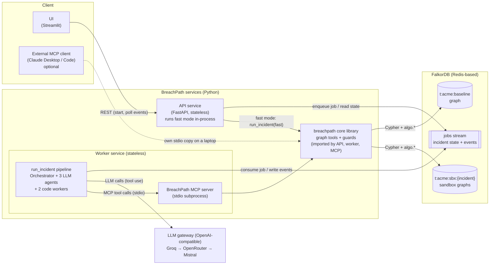
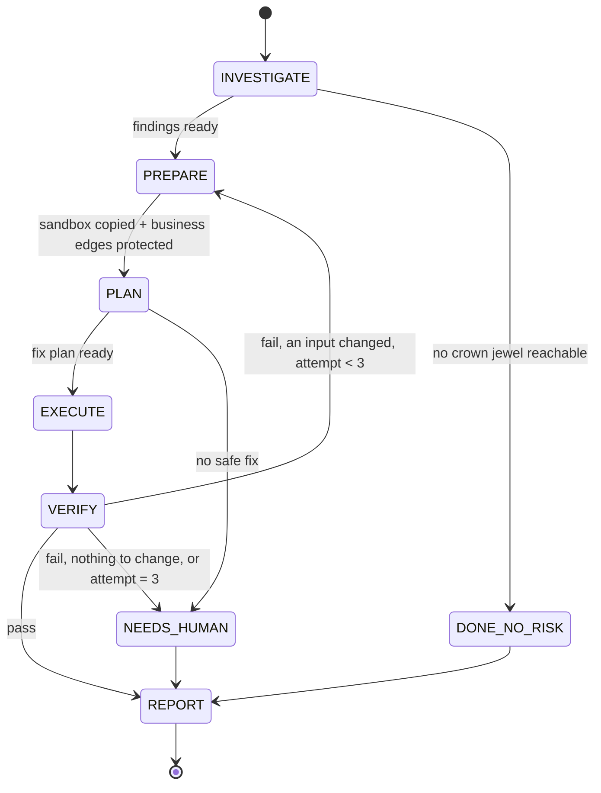
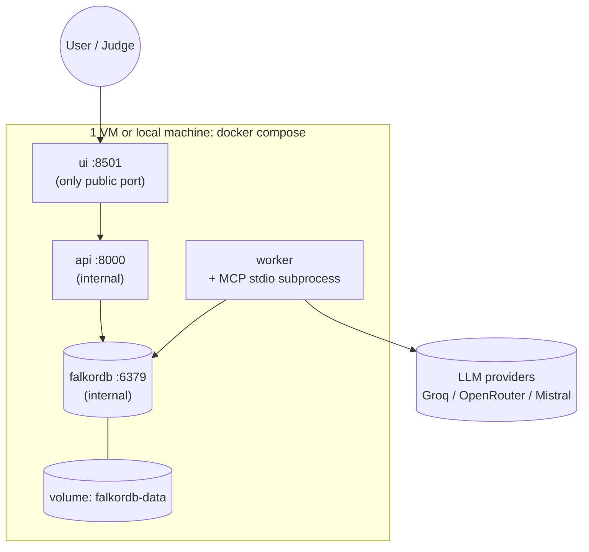

# 02: High-Level Design (HLD)

> **Status:** pre-hackathon planning sketch (Rule 8). Items marked **[VERIFY]** must be tested at kickoff.

---

## 1. Overview

BreachPath is a **multi-agent incident-response system** built on **FalkorDB**. A user reports a compromised identity. The system:

1. **Investigates** the attack paths (graph queries).
2. **Plans** the smallest safe fix (`algo.maxFlow` min-cut).
3. **Acts** on a sandbox copy of the graph.
4. **Verifies** with math (`maxFlow == 0`, business needs still reachable).
5. **Reports** in plain language.

---

## 2. Design principles

| # | Principle | What it means here |
|---|---|---|
| P1 | **Graph guarantees, LLM chooses** | Graph algorithms and code produce and **verify** the options (each blocks the attack and keeps every need). LLM agents investigate, **choose between verified options** (or propose new ones that must then pass verification), and explain. |
| P2 | **Deterministic core, agentic shell** | The same pipeline runs with no LLM (fast mode). The agents add tool choice, reasoning and narrative on top. |
| P3 | **Never touch the original** | All writes go to a per-incident sandbox graph. Enforced in code. |
| P4 | **Prove, don't claim** | Every fix is re-checked by the Verifier before it is reported. |
| P5 | **Stateless compute, stateful store** | API and workers keep no state. FalkorDB/Redis holds graphs, jobs and events. |
| P6 | **Boring tech, few parts** | Python only, 4 containers, one `docker compose up`, one shared pipeline. |

---

## 3. Architecture

**Why this shape:**
- The **API stays fast**: it only enqueues jobs and reads state, and never waits on an LLM.
- **Workers do the slow work** (LLM loops) and can be scaled out.
- **All graph access goes through one `core` library**, which gives one place for guards, timeouts, query logic and metrics. The **MCP server is a thin wrapper** over it. The worker starts the MCP server as a **stdio subprocess**, so LLM agents really choose and call tools through MCP (Track 1), with **no extra container and no network listener**. Fast mode calls the library directly. External MCP clients run the same server over stdio on their own machine.
- **One pipeline, two modes:** `run_incident(mode)` is the only orchestration code. Fast mode runs it synchronously in the API with code-only planning. Agent mode runs it in the worker with LLM agents. Nothing is written twice.
- **FalkorDB runs on Redis**, so the same instance also holds the job queue (Redis Streams) and incident state. That means **no extra database**.

---

## 4. Components

| # | Component | Responsibility | Tech | State |
|---|---|---|---|---|
| C1 | **UI** | Start an incident, show live agent timeline, path graph, fix, proof, eval table | Streamlit + graph view component | none |
| C2 | **API service** | REST endpoints, validation, idempotency, enqueue jobs, serve state and events, fast mode | FastAPI + Uvicorn | none |
| C3 | **Worker service** | Runs `run_incident(agent)`: Orchestrator state machine, the 3 LLM agents and the 2 code workers, checkpoints after each step. Starts the MCP server as a stdio subprocess. | Python, `openai` SDK (OpenAI-compatible providers), MCP client (stdio) | none (checkpoint in Redis) |
| C4 | **MCP server** | Thin MCP wrapper over `core` tools. **No container, no port.** Started by the worker over stdio, or by an external MCP client on a laptop. | Python MCP SDK 2.x (`MCPServer`, stdio transport) (verified P1.5: `mcp.server.mcpserver.MCPServer`, stdio) | none |
| C4b | **`core` library** | Graph tools (paths, min-cut, simulate, sandbox, verify), guards, timeouts, and the single `run_incident(mode)` pipeline | Python package imported by API, worker and MCP | none |
| C5 | **FalkorDB** | Baseline graph, sandbox graphs, algorithms, job stream, incident state, events | `falkordb/falkordb` Docker image (verified: FalkorDB 6.0.2 has `algo.maxFlow`, see `docs/VERIFY_RESULTS.md`) | **all state** |
| C6 | **Data generator and loader** | Build the synthetic company, plant scenarios, write answer keys, bulk load | Python script (seeded) | files |
| C7 | **Eval harness** | Score scenarios, run the JSON-dump baseline, brute-force the optimum | Python script | files |

---

## 5. Multi-agent design

### 5.1 Agents

| Agent | Type | Job | Tools (allow-list) | Output |
|---|---|---|---|---|
| **Orchestrator** | Code (state machine) | Runs the steps in order, handles retries and the loop limit, checkpoints | — | Next step |
| **Investigator** | LLM | Find the blast radius and attack paths. Decides which queries to run and how deep to go. | `get_blast_radius`, `find_attack_paths`, `shortest_paths`, `edge_path_frequency`, `get_node`, `get_edge`, `run_readonly_cypher` | `Findings` (JSON) |
| **Planner** | LLM | **Makes the real decision**: gets the minimum-size candidate cuts, **simulates** each one (and any cut it proposes itself) to see who else loses access, and picks by collateral → size → staleness. It can only submit a cut the simulation verified. | `compute_min_cut`, `simulate_cut`, `edge_path_frequency`, `choke_points`, `get_edge` | `FixPlan` (JSON) |
| **Executor** | Code | **PREPARE:** copy the baseline into a sandbox and protect business-path edges (before planning, so the min-cut sees them). **EXECUTE:** validate the plan (edges exist and aren't protected), then apply it to the sandbox. | `create_sandbox`, `protect_business_paths`, `apply_fix` | `ActionResult` |
| **Verifier** | Code | Prove the fix: `maxFlow == 0` and all business needs reachable | `verify_fix` | `Verdict` |
| **Reporter** | LLM | Write the plain-language incident report from the evidence | none (reads state only) | `Report` (Markdown) |

**3 LLM agents + 2 deterministic workers + 1 orchestrator.** We describe it this way in the README and never as "5 agents". The **Executor and Verifier are code on purpose**: the steps that *change* things and *judge* things must be deterministic and trustworthy.

**What the LLM agents actually decide** (the answer to "what does the AI do that code doesn't?"):
- **Investigator:** which queries to run, how deep to go, which jewels to look at first, and what's worth a closer look (`get_node` / raw read-only Cypher).
- **Planner:** **which of several equally small fixes to apply**, trading collateral against staleness and remediation type. It can also **invent and test its own cut**. The graph proves each option; the LLM weighs them.
- **Reporter:** what a manager needs to know, in plain words.

The **guarantee** (blocks the attack, keeps every need) comes from code. The **choice** between valid options comes from the LLM.

### 5.2 Coordination pattern: Orchestrator plus shared state

- The pattern is **supervisor / state machine**, not free-form agent chat. It's faster (no chatter between agents), cheaper and predictable.
- Agents share one **incident state** (a "blackboard") stored in Redis. Each agent reads what it needs and writes its typed output.
- **Handoffs are typed JSON** (`Findings` → `FixPlan` → `ActionResult` → `Verdict` → `Report`). If validation fails, the Orchestrator retries that agent once with the error.
- **Loop:** Verifier fails → retry **only if an input changes** (e.g. protect a broken need's alternative path, or drop a failed custom cut). Re-running deterministic code on the same inputs would repeat the same result. If nothing can change, or after 3 attempts → `NEEDS_HUMAN`. See LLD §7.1.

### 5.3 LLM layer: Groq then OpenRouter, called directly (decision D14)

**Providers:** `LLM_PROVIDERS=groq,openrouter` (the order is the fallback order; a provider without a key or model is skipped). Both offer an OpenAI-compatible Chat Completions API with tool calling, so one small `LLMGateway` (the `openai` Python SDK, `base_url` + key per provider) calls them **directly**. Groq is first (about 0.7 s per call, 1000 requests/day); OpenRouter is second (about 4 s, 50 free requests/day; it has its own Activity log, our calls carry `X-Title: BreachPath`). The per-incident trace is our own event stream (LLD §8). No new container.

| Setting | Value | Why |
|---|---|---|
| Provider chain | `LLM_PROVIDERS` in order. An agent run is **pinned** to one provider. If it is unavailable (after the one retry, or 401/403/404), the **whole run restarts on the next provider** with a fresh conversation (never mid-conversation, D18). All unavailable → `LLMUnavailable` → the agent loop **degrades to the fast brains** (`degraded: true`, AC-6). | Free quotas are small; Groq is fast, OpenRouter is the backup. |
| Observability | OpenRouter's Activity log + our incident events (LLD §8) | The per-incident trace is our own events: agent, tool, latency, provider, model |
| Model per agent per provider | Config (`MODEL_<AGENT>_<PROVIDER>`). **Chosen by a tool-calling smoke test** (B8, VERIFY_RESULTS P1.4). | Model lists and free tiers change. Pick what actually works. |
| Model selection criteria | Reliable tool calling · context ≥ 32k · low latency · free or cheap | The Investigator and Planner need good tool use. The Reporter can be a smaller model. |
| Temperature | `0` | Repeatable runs for eval and demo |
| Tool choice | `auto` in the loop. On the **last allowed turn**, force the `submit_*` function if the provider supports it. Otherwise rely on the prompt + validation. | Not every provider or model supports forced tool choice the same way |
| Output validation | **Pydantic validation in our code** (don't rely on provider "strict" modes) + one retry with the error message | Works the same with every provider |
| Parallel tool calls | Used when the model returns several calls. Otherwise run them one by one. | Varies by model |
| Streaming | Off in v1 | Events are emitted per tool call anyway. Simpler code. |
| Timeout / retries | 30 s per call, **1 retry** (the SDK's own retries are off), then `LLMUnavailable` | Low tail latency |
| **Response cache** | Record/replay keyed by `hash(provider, model, messages, tools, ...)` (not the trace id), stored in Redis | Re-running the eval or demo doesn't burn free-tier quota, and the demo is repeatable |

> **Correctness doesn't depend on model quality.** Smaller open models invent tool arguments more often. Our Executor validation, code Verifier and fast-mode fallback mean a weak model can make the *narrative* worse, but never makes the *fix or proof* wrong. This is a strong README point.

### 5.4 How agents use MCP

- The Worker is an **MCP client**. At startup it launches the BreachPath MCP server as a **stdio subprocess** (one per worker process), lists its tools, and converts each agent's **allow-listed tools** into OpenAI-format `tools` (function name, description, JSON schema). If the subprocess dies, the worker restarts it and retries the tool call once.
- When the model returns `tool_calls`, the Worker calls the MCP tool and sends back a `role: "tool"` message with the result.
- This meets the Track 1 focus on "tool selection through MCP", with no network listener at all: stdio is a private pipe between two processes.
- **Bonus:** the same MCP server can be added to Claude Desktop or Claude Code, so judges can call BreachPath tools directly.

---

## 6. Main flows (summary)

Full diagrams are in [04_Flow_Diagrams.md](04_Flow_Diagrams.md).

| Flow | Path |
|---|---|
| **Agent mode** | UI → `POST /incidents` → job queued → Worker runs Investigate → Prepare → Plan → Execute → Verify → Report → events stream to the UI |
| **Fast mode** | UI → `POST /analyze` → API runs **the same `run_incident` pipeline** with `mode=fast` (code-only planning, `core` called directly): paths → sandbox + protect (company-wide) → min-cut candidates → simulate both → pick by collateral (code ranking) → apply → verify → JSON in about 1–2 s |
| **Data load** | Generator → JSON → Loader → `UNWIND` batch insert → indexes → baseline graph |
| **Eval** | For each scenario: fast mode + agent mode + JSON-only baseline → score against the answer key |

---

## 7. Tech stack

| Layer | Choice | Why |
|---|---|---|
| Language | **Python 3.12** | One language everywhere, best LLM and graph libraries |
| Graph DB | **FalkorDB** (Docker locally, Docker or FalkorDB Cloud for the demo) | Required. Has `algo.maxFlow`, `algo.betweenness`, `algo.SPpaths`, `algo.bfs`, `GRAPH.COPY`. |
| DB client | `falkordb` Python client | Official |
| Queue / state | **Redis Streams + hashes in the same FalkorDB instance** | No extra service |
| API | FastAPI + Uvicorn | Async, fast, auto docs at `/docs` |
| MCP | Official MCP Python SDK 2.x (`mcp.server.mcpserver.MCPServer`; FastMCP no longer exists in 2.x), **stdio** transport | Standard. No port to secure. The same server works for external MCP clients on a laptop. |
| LLM | `openai` Python SDK against OpenAI-compatible providers (Groq, then OpenRouter, called directly) + our `LLMGateway` (one retry, cache); fallback = restart the run on the next provider | One code path. Easy to explain. |
| UI | Streamlit + a graph component (e.g. `streamlit-agraph` or `pyvis`) **[VERIFY pick on Day 3]** | Fastest way to build a usable UI in Python |
| Packaging | Docker Compose | One-command run |
| Tests | pytest | Simple |

---

## 8. Low-latency design

| Where | Technique |
|---|---|
| Graph lookups | Index on `id` for every label, and on edge `eid` (relationship indexes verified; they build asynchronously) |
| Graph queries | **Parameterized** queries, so FalkorDB can reuse cached query plans |
| Path search | **Bounded** hops (`*1..6`) + `LIMIT k` for display. The **decision** uses `maxFlow`, which needs no path enumeration. |
| Read queries | `GRAPH.RO_QUERY`, which can be sent to a replica when scaling |
| Algorithm scope | `relationshipTypes` filter on every `algo.*` call, so only attack edges are processed |
| Fast path | Fast mode (no LLM) for an instant answer. The agent narrative streams in afterwards. |
| LLM turns | Few, focused agents, with a max-turn cap per agent. Parallel tool calls when the model supports them. |
| LLM speed | **Groq first** for its fast inference. Small `max_tokens`. Short prompts that send only the needed state slice. |
| LLM repeats | Response cache (record/replay), so a repeated eval or demo run returns instantly |
| API | Returns `202` at once. The UI long-polls events (Redis `XREAD BLOCK`), which gives updates in under 1 s with no websockets. |
| Sandbox | `GRAPH.COPY` of a 150-node graph is tiny. At large scale, use the overlay approach in §9. |

---

## 9. Scalability design

| Dimension | Hackathon (v1) | Scale path |
|---|---|---|
| Concurrent incidents | 1 worker, several async incidents | N worker replicas in one Redis consumer group, since jobs are shared out automatically |
| API traffic | 1 replica | N replicas behind a load balancer (stateless) |
| Graph size | ~150 nodes | Bounded queries + maxFlow restricted to relationship types. Larger sizes are **untested**: variable-length path listing will need tighter bounds or per-target BFS. |
| Tenants | 1 (`acme`) | One graph per tenant. Map tenant → FalkorDB instance to shard. |
| Read load | Primary only | Read replicas for `RO_QUERY` tools |
| Sandbox cost | Full `GRAPH.COPY` per incident + 24 h cleanup | **Overlay**: keep removed edge ids in state, filter them in queries, and copy only when a write is needed |
| LLM throughput | SDK retries | Per-worker concurrency cap + queue backpressure |
| DB contention | Graphs, queue, state and cache in one FalkorDB instance (fine at about 150 nodes: algorithms take milliseconds) | Move the queue, state, locks and LLM cache to a **separate Redis**, so heavy graph algorithms can never slow the event bus |
| Min-cut input (Q7) | All attack edges loaded into Python (a few hundred) | Load only the sub-graph between src and the crown jewels (nodes reachable from src AND able to reach a jewel) |
| MCP subprocess | One per worker process | Unchanged: it scales with the workers |

---

## 10. Availability and reliability

| Concern | Design |
|---|---|
| Service crash | Docker `restart: unless-stopped` + `/healthz`. Stateless services restart in seconds. |
| Worker crash mid-incident | State checkpointed after **every agent step**. The job stays pending in the Redis consumer group, and another worker claims it and **resumes from the last step**. |
| Duplicate jobs | `Idempotency-Key` on `POST /incidents`. Sandbox name = incident id. `apply_fix` is idempotent (deleting a missing edge is a no-op). |
| LLM outage, rate limit or refusal | One retry → **restart the agent run on the next provider** → **degrade to fast mode** + template report. The incident still finishes, marked `degraded: true`. |
| Bad LLM output | Strict tool schemas + JSON validation of each handoff. One retry with the error, then fall back to the deterministic result. |
| Hallucinated fix | Executor checks that every `eid` exists and isn't protected. Verifier proves the result. A wrong fix can't be reported as success. |
| Long or slow queries | Per-query timeout **[VERIFY FalkorDB TIMEOUT config]** + hop bounds + `LIMIT` |
| DB durability | Redis AOF persistence on a Docker volume |
| DB failover (scale path) | FalkorDB primary + replica (Redis replication), or managed FalkorDB Cloud **[VERIFY options]** |
| Demo safety | Seeded data, scenario reset endpoint, pre-recorded video as backup |

---

## 11. Security design

| Threat | Control |
|---|---|
| Agent changes the real graph | Write tools accept **only** graph names matching `^t:[a-z0-9-]+:sbx:[a-z0-9-]+$`. Enforced in the MCP server. |
| Cypher injection from LLM input | All tool queries are fixed and parameterized. The only free-form tool is **read-only** + timeout + `LIMIT`. |
| Agent overreach | Each agent sees only its allow-listed tools |
| Prompt injection via data (e.g. a node name saying "ignore instructions") | Graph data is passed as tool *results*, never as instructions. The Executor and Verifier are code, not LLM. |
| Secret leakage | `.env` file (git-ignored) + `.env.example`. No secrets in logs. |
| Public demo abuse (LLM cost) | `POST /incidents` (agent mode, which spends LLM tokens) needs a demo token + rate limit + max 2 concurrent incidents. Fast mode (no LLM) is open but rate-limited. |
| MCP server abuse | See §11.1. The MCP server has **no network listener at all** (stdio only). |

### 11.1 MCP exposure: the problem and the fix

**The problem.** An MCP server over HTTP has no login by default. Anyone who can reach its URL can list and call **every** tool. Our baseline guard stops writes to the baseline, but an outsider could still:

| Attack | Tool abused | Effect |
|---|---|---|
| Tamper with a live incident | `apply_fix` / `protect_business_paths` on another incident's sandbox | Changes the sandbox mid-run, so a demo shows a wrong verdict |
| Exhaust memory | `create_sandbox` in a loop | Thousands of graph copies; FalkorDB runs out of RAM |
| Slow everything down | `run_readonly_cypher` with a huge query; `find_attack_paths` with big `k` | CPU pinned; every user waits |
| DNS rebinding (when run locally) | any tool | A malicious web page in your browser calls `localhost` MCP. The MCP spec says HTTP servers must check the `Origin` header and should bind to localhost. |

**Options:**

| Option | How | Safety | Effort | Verdict |
|---|---|---|---|---|
| **A. stdio only** | MCP has **no network listener**. The worker starts it as a stdio subprocess. For the "Claude Desktop / Code uses our tools" demo, the MCP client on your laptop starts its own copy over stdio. Record it in the video. | Highest | Lowest | ✅ **Chosen for v1** |
| B. Internal + public read-only | A 2nd instance started with `MCP_PROFILE=public`, which registers **read tools only** (no write tools, no raw Cypher), plus bearer-token auth, rate limit, `Origin` check, and a fixed demo graph | High | Medium | Optional on Day 4 if judges should try the tools live |
| C. One server, per-token scopes | Token says `read` or `write`, and each tool checks the scope | Medium (one bug exposes writes) | Medium | ❌ |
| D. Full MCP OAuth | OAuth 2.1 flow per the MCP auth spec | High | High | ❌ Too heavy for 4 days |

**Plus, in every option:** write tools accept a sandbox only if its incident is currently running and owned by the calling worker (lock check). Incident ids are random UUIDs, so they can't be guessed.

**Deployed setup (decided):**

| # | Control | Time |
|---|---|---|
| 1 | Only the **UI** has a public port. `api` and `falkordb` use `expose` (internal Docker network), never `ports`. The UI calls the API server-side. **The API docs page (`/docs`) is local-only.** | 10 min |
| 2 | **MCP has no listener** (stdio subprocess), so there is nothing to reach. *This replaces the earlier internal-token idea.* | 0 min |
| 3 | Write guards (name, lock owner, quota): LLD §5 | 1–2 h |
| 4 | FalkorDB password (`requirepass`) + RO queries + timeouts | 30 min |
| 5 | Agent mode: demo token + rate limit + max 2 concurrent incidents | 1 h |
| 6 | HTTPS on the UI (platform TLS, or Caddy on a VM) | 30–60 min |
| 7 | Secrets only in a git-ignored `.env` | 10 min |

**Platform caveat:** some free platforms give every service a public URL by default. Use the platform's private networking, or one VM with Docker Compose, so control 1 holds. Check this on Day 3, **before** choosing a platform.
**Not in scope (README "Security scope"):** user login or OAuth, mTLS between containers, pen-testing, a WAF.

---

## 12. Deployment

| Environment | Setup |
|---|---|
| **Local (first priority)** | `docker compose up`. All **4 containers** (falkordb, api, worker, ui) on one machine. This must work fully before any cloud work. `docker-compose.dev.yml` adds local-only ports (API docs, FalkorDB browser, FalkorDB on `127.0.0.1`). |
| **Live demo (later)** | Pick a free platform on Day 3 **[VERIFY current free tiers then]**: candidates are free container hosts, or a free VM running the same compose file, with FalkorDB in Docker or on FalkorDB Cloud. If none fits, submit with full local setup steps + video (Rule 10 allows this). |
| **Scale path (documented only)** | Containers on a managed container platform. FalkorDB with replicas or managed. API and worker autoscale. |

---

## 13. Design decisions

| # | Decision | Chosen | Alternatives considered | Why |
|---|---|---|---|---|
| D1 | How to find the minimum fix | `algo.maxFlow` + residual search (max-flow = min-cut) | Greedy betweenness; brute force | Exact and polynomial. Greedy betweenness can be non-minimal (scenario S6 shows this). Brute force doesn't scale. |
| D2 | How to protect business access | Capacity = edge count + 1 on business-path edges, for **company-wide** needs (explicit + recent usage) | Fixed 1000; only the src's needs; post-check only | Built into the math. Edge count + 1 can never be reached by removable edges alone, so there's no "1000 paths" false alarm. Company-wide needs stop silent collateral. |
| D3 | How to prove the fix | Re-run `maxFlow` on the sandbox → must be 0 | Re-enumerate paths | maxFlow isn't hop-limited, so it's a **complete** proof. Path listing is bounded. |
| D4 | Where changes happen | Per-incident `GRAPH.COPY` sandbox | In-place with rollback | Safe, simple, parallel incidents |
| D5 | Agent coordination | Code state machine + shared state | Free-form multi-agent chat; LangGraph | Predictable, fast, easy to explain and debug. No framework to learn under time pressure. |
| D6 | Who judges correctness | Code (Executor, Verifier) | LLM verifier | An LLM can't be trusted to grade its own fix |
| D7 | Queue and state store | Redis Streams in the FalkorDB instance | Celery + separate Redis; Kafka | No extra service. Consumer groups give retry and resume. |
| D8 | MCP server | Our own domain MCP server (Python) | Only the official FalkorDB MCP server (`query_graph`) | Domain tools are safer (no free-form writes) and easier for agents to choose between. The official server can still be added for exploration. |
| D9 | UI | Streamlit | React + Cytoscape.js | 4 days, Python team. Good enough for the demo. |
| D10 | Business needs storage | Isolated `:BusinessNeed` nodes (no edges) | `NEEDS_ACCESS` edges | Edges would be traversed as fake attack paths by `algo.bfs` and similar calls |
| D11 | Scenario graphs | **Decided (Option C):** one graph per scenario = shared background company + that one scenario. Ground truth computed on the **final** graph by an independent reference (Python `networkx`, eval only). | One graph per bare scenario; all scenarios in one graph | Realistic **and** exact answer keys. See LLD §10.1. |
| D12 | MCP exposure | **stdio only** (Option A, §11.1): no listener at all | HTTP container with internal token; public read-only; scoped tokens; OAuth | Safest and simplest. The external-client demo runs its own stdio copy. |
| D19 | MCP placement | Thin MCP server over a shared **`core` library**, started by the worker as a **stdio subprocess** | Separate MCP container over HTTP | One fewer container, nothing to secure. Agents still truly use MCP (Track 1). |
| D20 | Orchestration code | **One pipeline `run_incident(mode)`** for both fast and agent mode | Separate fast-mode route + worker state machine | Logic is written once and can't drift between modes |
| D14 | LLM providers | **Groq then OpenRouter** (`LLM_PROVIDERS`), OpenAI-compatible, called directly, + response cache. *History: chain of three → one provider (a hosted trace gateway was tried and dropped: no account) → two providers again because the free quotas are small.* | One provider; LiteLLM; a hosted gateway | OpenRouter free is 50 requests/day; Groq is faster with 1000/day. Thin code you can explain. |
| D13 | "No safe fix" suggestion | **Deterministic split simulation** (Role/Policy/Group only), proven in a 2nd sandbox (LLD §4.1). The LLM only words it. | LLM-only suggestion | Keeps "prove, don't claim" true even for the suggestion |
| D15 | Choosing among equal-size cuts | **LLM Planner** picks by **collateral** (Q12 simulation) → size → staleness, and may propose its own cut if `simulate_cut` verifies it | Fixed rule "prefer stale"; always source-side | Stale-first favours edges next to the DB (most collateral). This is also where the LLM makes a real decision. |
| D16 | Retry on verification failure | Retry **only when an input changes**. Otherwise `NEEDS_HUMAN`. | Blind retry ×3 | Deterministic code on the same input repeats the same result |
| D17 | Justifying cut edges | **Witness path per cut edge** from the flow itself | Point to Investigator path indices | Cut edges can sit on paths that aren't listed (> 6 hops or beyond top-K) |
| D18 | Provider fallback | Pin a provider per agent run. If it is unavailable, **restart that agent's run (fresh conversation) on the next provider**. All unavailable → degrade to the fast brains. | Switch mid-conversation | Tool-call ids and formats differ between providers |

---

## 14. Why FalkorDB is not decoration (Rule 3)

| Remove FalkorDB and… |
|---|
| …there are no attack paths (variable-length Cypher) |
| …there is no choke-point ranking (`algo.betweenness`) |
| …there is no minimum fix (`algo.maxFlow`) |
| …there is no sandbox (`GRAPH.COPY`) |
| …there is no proof (`maxFlow == 0` after the fix) |
| …there is no job queue or state (Redis in the same instance) |

**→ Without FalkorDB the product does nothing.** The eval compares it with realistic baselines (disable-user, greedy betweenness, greedy path frequency, LLM + JSON dump) to show this with numbers.

**"Why not just networkx?"** (a judge may ask, since the eval uses networkx as a test oracle). networkx is an in-memory, single-process library. The product needs what a database gives:
- **persistent** graphs;
- **per-incident sandbox copies** (`GRAPH.COPY`) that run side by side;
- **one graph per tenant**;
- **concurrent** readers and writers (API, workers, MCP);
- **Cypher** as the agents' query language through MCP;
- **algorithms that run next to the data** (`algo.maxFlow`, `algo.bfs`, `algo.SPpaths`, `algo.betweenness`) with no export step;
- the job queue and state in the **same instance**.

Using a *different* library as the test oracle is deliberate: two independent implementations agreeing is stronger evidence than one checking itself.
