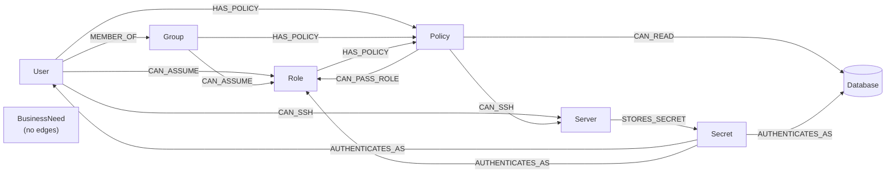

# 03: Low-Level Design (LLD)

> **Status:** pre-hackathon planning sketch (Rule 8). The queries and pseudocode are design notes, not final code.
> **[VERIFY]** = test this exact syntax on the real FalkorDB at kickoff.

---

## 1. Repository layout

```
breachpath/
├── docker-compose.yml          # falkordb, api, worker, ui   (4 containers; only ui public)
├── docker-compose.dev.yml      # LOCAL ONLY: api docs :8000, FalkorDB browser :3000, FalkorDB on 127.0.0.1:6379
├── Dockerfile                  # one image for api/worker/ui (different commands)
├── .env.example
├── README.md
├── data/
│   ├── generator.py            # seeded synthetic company + planted scenarios
│   ├── scenarios/              # s1.yaml … s8.yaml  (scenario definitions)
│   └── answer_keys/            # s1.json … s8.json  (ground truth)
├── core/                       # THE shared library: imported by api, worker and mcp_server
│   ├── graph/
│   │   ├── schema.py           # labels, edge types, ATTACK_TYPES, indexes
│   │   ├── loader.py           # UNWIND batch loader
│   │   ├── queries.py          # all Cypher strings (parameterized)
│   │   ├── mincut.py           # residual-graph min-cut + witness paths
│   │   └── client.py           # FalkorDB connection, timeouts, RO vs RW
│   ├── tools/
│   │   ├── read.py             # paths, blast radius, betweenness, min-cut, simulate_cut …
│   │   ├── write.py            # sandbox, protect, apply_fix
│   │   ├── verify.py           # verify_fix
│   │   └── guards.py           # sandbox-name guard, lock owner, quota, eid validation
│   └── pipeline.py             # run_incident(mode): the ONE orchestration pipeline (fast + agent)
├── mcp_server/
│   └── server.py               # thin MCPServer (mcp 2.x) wrapper over core.tools, stdio transport only
├── agents/
│   ├── base.py                 # LLM tool-use loop (MCP client → OpenAI-format tools)
│   ├── llm_gateway.py          # provider chain (Groq/OpenRouter/Mistral), retries, response cache
│   ├── investigator.py
│   ├── planner.py
│   ├── executor.py             # code-only
│   ├── verifier.py             # code-only
│   ├── reporter.py
│   ├── schemas.py              # Findings, FixPlan, ActionResult, Verdict, Report
│   └── prompts/                # investigator.md, planner.md, reporter.md
├── orchestrator/
│   ├── state_machine.py        # steps, transitions, retry policy (used by core/pipeline.py)
│   ├── state.py                # incident state load/save (checkpoint)
│   ├── lock.py                 # incident lock + heartbeat task
│   └── events.py               # event emitter (Redis stream)
├── api/
│   ├── main.py                 # FastAPI app
│   └── routes/                 # scenarios, analyze, incidents, eval, health
├── worker/
│   └── main.py                 # consumer loop, starts MCP stdio subprocess, janitor
├── ui/
│   └── app.py                  # Streamlit
├── eval/
│   ├── run_eval.py
│   ├── baseline_json_llm.py    # same LLM, JSON dump, no graph tools
│   ├── bruteforce.py           # true optimum for small scenarios
│   └── metrics.py
└── tests/
```

---

## 2. Graph data model

### 2.1 Naming

**Tenant = scenario.** Each scenario is its own tenant: `s1` … `s8` (decision D11, Option C, decided).

| Graph key | Purpose | Who writes | Lifetime |
|---|---|---|---|
| `t:{scenario}:baseline` | Background company + one planted scenario | Loader only | Until the next reload |
| `t:{scenario}:sbx:{incident_uuid}` | Per-incident sandbox | Executor (MCP write tools) | 24 h (janitor) |
| `t:{scenario}:sbx:{incident_uuid}-split` | Split-simulation sandbox (§4.1) | Planner helper (code) | 24 h |
| `t:{scenario}:sbx:fast-{uuid8}` | Fast-mode sandbox | API fast mode | Deleted at the end of the request (`finally`). Janitor removes leftovers after 1 h. |

**Reload rule:** `POST /scenarios/{sid}/load` returns `409 Conflict` if any incident on that scenario is active (Redis set `active:{scenario}`). Otherwise it deletes the baseline and loads it fresh. Old sandboxes are left alone (they are copies).

### 2.2 Node labels

Every node has the shared label **`:Asset`** plus one type label, so a single index on `Asset.id` finds any node.

| Label | Properties | Example |
|---|---|---|
| `:Asset:User` | `id`, `name`, `user_type` (`human`/`service`), `team` | `user:ravi` |
| `:Asset:Group` | `id`, `name` | `group:ci-deployers` |
| `:Asset:Role` | `id`, `name`, `env` | `role:deploy-role` |
| `:Asset:Policy` | `id`, `name`, `actions` (string list) | `policy:deploy-staging` |
| `:Asset:Server` | `id`, `name`, `env` | `server:build-server` |
| `:Asset:Database` | `id`, `name`, `env`, `crown_jewel` (bool), `sensitivity` | `db:customers` |
| `:Asset:Secret` | `id`, `name`, `secret_type` | `secret:billing-svc-pw` |
| `:BusinessNeed` | `id`, `principal_id`, `resource_id`, `reason`, `source` (`explicit` / `usage`), `valid` (**no edges**) | `need:ravi-staging` |

**Business needs cover the whole company, not just the compromised user.** There are two sources:
- `explicit`: written in the scenario YAML, e.g. Ravi → staging.
- `usage`: generated for **every** principal. For each human and service user, every resource (Server/Database) they reach through a path whose edges were **all** used in the last `NEED_USAGE_DAYS` (30) days becomes a need.

This is what stops a fix from silently breaking access for the other 49 users (critique fix #1).

### 2.3 Edge types (all directed, meaning "if you control FROM, you gain TO")

| Type | From → To | Meaning | Real-world remediation when cut |
|---|---|---|---|
| `MEMBER_OF` | User → Group | User gets the group's rights | Remove user from group |
| `CAN_ASSUME` | User, Group → Role | Can switch into the role | Edit the role's trust policy |
| `HAS_POLICY` | User, Group, Role → Policy | Gets the policy's permissions | Detach the policy |
| `CAN_READ` | Policy → Database | Can read the data | Remove the statement from the policy |
| `CAN_SSH` | User, Policy → Server | Can log into the server | Revoke the SSH key / access grant |
| `CAN_PASS_ROLE` | Policy → Role | **Privilege escalation**: can create compute that runs as that role (`technique` names the method) | Remove `PassRole` for that role from the policy |
| `STORES_SECRET` | Server → Secret | The secret is saved on that server | **Delete the file and rotate the secret** (a host action, not an IAM call) |
| `AUTHENTICATES_AS` | Secret → User, Role, Database | Whoever holds the secret becomes that identity | Rotate the credential |

> The Reporter always uses the **remediation verb**, never "delete edge". Some fixes are host actions, not IAM changes, and the report says so.

`ATTACK_TYPES = [MEMBER_OF, CAN_ASSUME, HAS_POLICY, CAN_READ, CAN_SSH, CAN_PASS_ROLE, STORES_SECRET, AUTHENTICATES_AS]`

**Edge properties:**

| Property | Type | Meaning |
|---|---|---|
| `eid` | string, unique | Stable edge id, e.g. `e:0042`. Used everywhere: plans, reports, answer keys. |
| `cap` | int | Max-flow capacity. `1` = removable. Set to `PROTECT_CAP` in the sandbox if protected. `PROTECT_CAP` = (number of edges in the graph) + 1, computed per sandbox, so no cut made only of removable edges can ever reach it. |
| `w` | int | `1`. Weight for `algo.SPpaths` (hop count). |
| `last_used_days` | int | Days since last use. A **secondary** tie-break when choosing a cut. Collateral comes first (§4.2). |
| `technique` | string, optional | For escalation edges, e.g. `PassRole+CreateFunction` |
| `protected` | bool, sandbox only | `true` if the edge is on a business-need path |

> **Rule (decision D10):** every edge in the graph is an attack edge. Business needs are **nodes without edges**, so whole-graph algorithms (`algo.bfs` with `null` type) stay correct.

### 2.4 Model picture



### 2.5 Indexes (verified P1.3: relationship indexes work and build **asynchronously**, starting as `UNDER CONSTRUCTION`)

```cypher
CREATE INDEX FOR (n:Asset) ON (n.id)
CREATE INDEX FOR (n:Database) ON (n.crown_jewel)
CREATE INDEX FOR (n:BusinessNeed) ON (n.id)
// one per edge type:
CREATE INDEX FOR ()-[r:MEMBER_OF]-() ON (r.eid)
CREATE INDEX FOR ()-[r:CAN_ASSUME]-() ON (r.eid)
// … same for every type in ATTACK_TYPES
```

---

## 3. Cypher queries

All queries are **parameterized**. `$types` = `ATTACK_TYPES`. `{T}` below means the literal type list `MEMBER_OF|CAN_ASSUME|…` (types can't be parameters inside a pattern, so they're written into the query string from a constant, never from user input).

### Q0: Load (per label and per edge type, in batches)

> P1.3 finding: a whole map parameter can't be used as inline properties (`CREATE ()-[:R $p]->()` fails with *"Encountered unhandled type in inlined properties"*). Use explicit fields (`{eid: row.eid, …}`) or `SET r += row.props`.

```cypher
// nodes (one query per label)
UNWIND $rows AS row
CREATE (:Asset:User {id: row.id, name: row.name, user_type: row.user_type, team: row.team})

// edges (one query per type)
UNWIND $rows AS row
MATCH (a:Asset {id: row.src}), (b:Asset {id: row.dst})
CREATE (a)-[:MEMBER_OF {eid: row.eid, cap: 1, w: 1,
                        last_used_days: row.last_used_days, technique: row.technique}]->(b)
```

### Q1: Blast radius

```cypher
MATCH (s:Asset {id: $src})-[:{T}*1..6]->(t:Database {crown_jewel: true})
RETURN DISTINCT t.id AS id, t.name AS name
```
> A variable-length bound usually can't be a query parameter, so `6` comes from the `MAX_HOPS` config, written into the string. **[VERIFY]**
> For a **complete** (unbounded) check, use Q9 (`algo.bfs`) instead.

### Q2: Attack paths, top-K by hops

```cypher
MATCH p = (s:Asset {id: $src})-[:{T}*1..6]->(t:Database {crown_jewel: true})
RETURN t.id AS target,
       [n IN nodes(p) | n.id]          AS node_ids,
       [r IN relationships(p) | r.eid] AS eids,
       length(p)                       AS hops
ORDER BY hops ASC
LIMIT $k
```

### Q3: Shortest paths per target (`algo.SPpaths`) (verified P1.3: `relDirection:'outgoing'`, `weightProp`, `pathCount`, `maxLen` accepted; **no path → no rows**)

```cypher
MATCH (s:Asset {id: $src}), (t:Asset {id: $target})
CALL algo.SPpaths({sourceNode: s, targetNode: t, relTypes: $types,
                   relDirection: 'outgoing', weightProp: 'w',
                   pathCount: $k, maxLen: 8})
YIELD path, pathWeight
RETURN [r IN relationships(path) | r.eid] AS eids, pathWeight AS hops
```

### Q4: Edge path frequency (incident-specific choke points)

```cypher
MATCH p = (s:Asset {id: $src})-[:{T}*1..6]->(t:Database {crown_jewel: true})
WITH p LIMIT $max_paths
UNWIND relationships(p) AS r
RETURN r.eid AS eid, type(r) AS type, count(*) AS paths_through
ORDER BY paths_through DESC
LIMIT $top
```

### Q5: Betweenness (global hint)

```cypher
CALL algo.betweenness({relationshipTypes: $types, samplingSize: $n, samplingSeed: 42})
YIELD node, score
RETURN node.id AS id, labels(node) AS labels, score
ORDER BY score DESC
LIMIT $top
```
> `samplingSize` defaults to 32, which makes the result **approximate**. Set `$n` to at least the node count (about 150) to get near-exact results on small graphs. Betweenness is **global**, so it's only a hint. The decision comes from Q6.

### Q6: Max flow (input to the min-cut) (verified P1.3: `CALL` after `WITH collect()` works; multi-target works; respects direction; **zero flow → one row with `maxFlow = 0.0`**; values are **floats**; `edges` carry properties and line up with `edgeFlows`)

```cypher
MATCH (s:Asset {id: $src})
MATCH (t:Database {crown_jewel: true})
WITH s, collect(t) AS targets
CALL algo.maxFlow({sourceNodes: [s], targetNodes: targets,
                   relationshipTypes: $types, capacityProperty: 'cap'})
YIELD edges, edgeFlows, maxFlow
RETURN [e IN edges | e.eid] AS flow_eids, edgeFlows, maxFlow
```

### Q7: All attack edges (for the residual graph)

```cypher
MATCH (a)-[r:{T}]->(b)
RETURN r.eid AS eid, a.id AS u, b.id AS v, r.cap AS cap, type(r) AS type,
       r.last_used_days AS stale_days
```
> v1 loads every edge (about 150 nodes and a few hundred edges). Scale path: only the edges reachable from `$src`.

### Q8: Protect business paths (sandbox only)

```cypher
// step 1: PROTECT_CAP = edge count + 1
MATCH ()-[r]->() RETURN count(r) + 1 AS protect_cap

// step 2: for EVERY valid need (company-wide), protect one shortest path
MATCH (n:BusinessNeed {valid: true})
MATCH (a:Asset {id: n.principal_id}), (b:Asset {id: n.resource_id})
CALL algo.SPpaths({sourceNode: a, targetNode: b, relTypes: $types,
                   relDirection: 'outgoing', weightProp: 'w', pathCount: 1})
YIELD path
UNWIND relationships(path) AS r
SET r.cap = $protect_cap, r.protected = true
RETURN n.id AS need_id, collect(r.eid) AS protected_eids
```
> On a retry with `failure_detail = need X broken`, the Executor also protects need X's **second** shortest path (`pathCount: 2`). That's a *changed input*, so the retry can give a different result (§7.3).

### Q9: Complete reachability check (`algo.bfs`)

```cypher
MATCH (s:Asset {id: $src})
CALL algo.bfs(s, $depth, null)
YIELD nodes
RETURN [n IN nodes WHERE n:Database AND n.crown_jewel = true | n.id] AS reached_jewels
```
> `null` = all relationship types. This is correct **only because** every edge is an attack edge (D10). `$depth` = 50 (larger than any real path).

### Q10: Apply fix (sandbox only, idempotent)

```cypher
UNWIND $eids AS eid
MATCH ()-[r]->()
WHERE r.eid = eid AND coalesce(r.protected, false) = false
DELETE r
RETURN count(*) AS deleted
```
> Deleting an edge that's already gone matches nothing, so running it twice is safe. Scale path: group by type to use the per-type `eid` index.

### Q11: Business need check (after the fix)

```cypher
MATCH (n:BusinessNeed)
MATCH (a:Asset {id: n.principal_id}), (b:Asset {id: n.resource_id})
CALL algo.SPpaths({sourceNode: a, targetNode: b, relTypes: $types,
                   relDirection: 'outgoing', weightProp: 'w', pathCount: 1})
YIELD path
RETURN n.id AS need_id, count(path) > 0 AS ok
```
> Verified P1.3: `SPpaths` returns **no row** when there's no path. So compute `ok` in Python: every valid need id that is missing from the result = not ok.

### Q12: Reach sets of all principals (for collateral)

```cypher
MATCH (u:User) WHERE u.id <> $src
CALL algo.bfs(u, 50, null)
YIELD nodes
RETURN u.id AS principal,
       [n IN nodes WHERE n:Server OR n:Database | n.id] AS reaches
```
> Run once on the prepared sandbox (**before**), and again on a candidate's simulation copy (**after**). Collateral = every `(principal, resource)` pair in *before* but not in *after*. About 50 BFS runs on about 150 nodes, which is cheap.

---

## 4. Min-cut algorithm (`graph/mincut.py`)

**Idea:** by the max-flow / min-cut theorem, after a maximum flow, the nodes the source can still reach in the **residual graph** form set S. Every original edge from S to outside S is in a minimum cut, and their capacities add up to `maxFlow`.

```text
INPUT : src, edges[] from Q7 (eid, u, v, cap), flow_eids[] + edgeFlows[] + maxFlow from Q6, PROTECT_CAP
OUTPUT: candidates[], max_flow, safe

1. flow[eid] = edgeFlows[i] for each flow_eids[i]; missing eid → 0
2. Build the residual adjacency:
     for e in edges:
        if e.cap - flow[e.eid] > EPS : add arc u → v
        if flow[e.eid] > EPS         : add arc v → u      (backward arc)
   NOTE: a protected edge (cap = PROTECT_CAP) carrying flow 1 still has residual > 0, so the BFS
         CROSSES it. That is CORRECT: cut edges must be saturated, and a protected edge never is.
         Do NOT block protected edges in this BFS. That would break the max-flow = min-cut equality.
3. S = BFS(src) over residual arcs
4. source_cut = [e for e in edges if e.u in S and e.v not in S]
5. SANITY: assert |sum(e.cap for e in source_cut) - maxFlow| < EPS     ← catches wrong assumptions
6. safe = maxFlow < PROTECT_CAP          (PROTECT_CAP = edge count + 1 → no "1000 paths" false alarm)
7. sink_cut: T = nodes that reach any target over residual arcs (reverse BFS);
             sink_cut = [e for e in edges if e.u not in T and e.v in T]      (same size)
8. WITNESS PATH per cut edge e(u→v), from the flow itself:
     walk backward from u to src along edges with flow > 0, and forward from v to a target along edges with flow > 0
     (flow conservation guarantees both walks exist). witness[e] = that eid list.
     → every cut edge is justified even if its path is longer than 6 hops or wasn't in the Investigator's top-K.
9. return candidates = [{name: "source_side", eids, witness}, {name: "sink_side", eids, witness}], maxFlow, safe
```

**Why it's correct:**
- **Minimal:** max-flow = min-cut, and with `cap = 1` that's the fewest edges.
- **Never cuts business access:** any cut containing a protected edge costs ≥ `PROTECT_CAP` > (all removable edges together). So if `maxFlow < PROTECT_CAP`, the min-cut contains no protected edge.
- **No safe fix:** if `maxFlow ≥ PROTECT_CAP`, every cut must include a protected edge → split simulation (§4.1).
- **Honest limit:** keeping *many* pairs connected while cutting one is a harder problem than plain min-cut (no simple exact algorithm). Our version is **always safe** (needs are protected) and **close to minimal**. The eval measures the gap against brute force (05 §3 L1).

### 4.2 Choosing between candidate cuts (the Planner's real decision)

Several cuts can have the same minimum size. They differ in **who else loses access**. The Planner (LLM) chooses, using evidence from `simulate_cut`:

| Order | Criterion | Source |
|---|---|---|
| 1 | **Collateral**: number of `(other principal, resource)` pairs that lose access (Q12 before/after). Weighted: recently used = 3, stale = 1. | `simulate_cut` |
| 2 | **Size** vs the minimum (`max_flow`) | `simulate_cut` |
| 3 | **Staleness**: total `last_used_days` (higher is better) | `simulate_cut` |
| 4 | **Remediation type**: prefer IAM changes over host actions | edge type |

**Fast mode and degraded mode** (no LLM) apply the **same ranking in code** to the two candidates, so they are deterministic and still collateral-aware. In agent mode, the LLM adds judgment on top of that ranking: custom cuts and the trade-off explanation.

The Planner may also **propose its own cut** (e.g. combining edges from both candidates, or using `edge_path_frequency` ideas). Any proposal is tested with `simulate_cut`. **Only cuts that `simulate_cut` reports as `blocks_attack = true` and `needs_ok = true` may be submitted.** The final report shows `cut size − minimum` (0 = optimal).

### 4.1 "No safe fix": deterministic split simulation (decision D13)

When `maxFlow ≥ PROTECT_CAP`, the min-cut contains protected edges. A node on a business path also leads the attacker onward. We compute the suggestion **in code and prove it** in a second sandbox. The LLM only puts it into words.

```text
INPUT : sandbox S (protected), cut C, flow from Q6, protected paths per need
P = [e in C if e.protected]

CASE 0: some need's resource IS a crown jewel and its principal IS the compromised src
        → "Unavoidable: this identity legitimately needs <jewel>. Rotate/disable its credentials."
          (no permission change can help; proven by definition) → return

for each protected edge p in P:
   1. Walk the business path forward from p's end node.
      D = first node on that path that has an outgoing edge with flow > 0
          that is NOT on any protected path        (the "divergence node": the business and attack paths split here)
      ONLY Role, Policy or Group nodes can be split (they're config objects).
      If D is a Server, User, Secret or Database → no split; suggestion = "rotate credentials / isolate host"
      for that node, proven = false → continue with the next p.
   2. S2 = GRAPH.COPY S → t:{sc}:sbx:{inc}-split
   3. In S2: create D' = copy of D (id = D.id + "-biz", same labels/props)
             move the protected incoming edge of D (the one on the business path) → points to D'
             copy D's protected outgoing edges to D' (cap = PROTECT_CAP)
   4. Re-run min-cut on S2. If safe: apply that cut on S2 and run the Verifier on S2.
   5. If pass → suggestion PROVEN:
        "Split <D> into <D> and <D>-biz. <principal> keeps <D>-biz (only <business edges>).
         Then remove <cut edges>. Verified: maxFlow = 0, all needs ok."
   else → try the next p. If none passes → suggestion = "manual review", proven = false.

OUTPUT: {suggestion_type: "rotate_credentials"|"split_node"|"manual", split_node, new_node,
         moved_edges, then_remove, proven: bool}
```
> The suggestion is shown as **"verified"** only if `proven = true`. The baseline is never changed.

---

## 5. MCP tools (`mcp_server/`)

| Tool | Inputs | Output | R/W | Guard / limit |
|---|---|---|---|---|
| `get_blast_radius` | `graph, src` | `[{id, name}]` | R | RO query, timeout |
| `find_attack_paths` | `graph, src, target?, k≤50` | `[{target, node_ids, eids, hops}]`, `truncated` | R | hops ≤ 6, `LIMIT k` |
| `shortest_paths` | `graph, src, target, k≤10` | `[{eids, hops}]` | R | |
| `edge_path_frequency` | `graph, src, top≤20` | `[{eid, type, paths_through}]` | R | `max_paths` = 500 |
| `choke_points` | `graph, top≤20` | betweenness + frequency merged | R | sampling = node count |
| `compute_min_cut` | `graph, src` | `{candidates: [{name, eids, witness: {eid: [eids]}}], max_flow, safe, protect_cap, protected_in_way[], split_suggestion}`. `split_suggestion` comes from §4.1 when `safe=false`. | R* | sanity assert. *Creates the `-split` sandbox internally (guarded) |
| `simulate_cut` | `sandbox, src, eids[]` | `{blocks_attack, needs_ok, broken_needs[], collateral: {count, weighted, pairs[≤20]}, size, min_size, stale_days_total}` | R* | `GRAPH.COPY` → `-sim-{n}`, apply, run Verifier + Q12, `GRAPH.DELETE`. Max 6 per incident. Guarded. |
| `check_business_access` | `graph` | `[{need_id, ok}]` | R | |
| `get_node` / `get_edge` | `graph, id` / `graph, eid` | properties + neighbors | R | |
| `run_readonly_cypher` | `graph, query, params` | rows (≤ 200) | R | **`GRAPH.RO_QUERY` only**, timeout, row cap |
| `create_sandbox` | `tenant, incident_id` | `{sandbox}` | **W** | dest must match the sandbox pattern. If it exists, reuse it (idempotent). |
| `protect_business_paths` | `sandbox` | `{protected_eids, unreachable_needs}` | **W** | sandbox guard |
| `apply_fix` | `sandbox, eids[], reason` | `{deleted, missing, refused_protected}` | **W** | sandbox guard; refuses protected edges |
| `verify_fix` | `sandbox, src` | `Verdict` | R | runs Q6 + Q9 + Q11 |

**Write guards** (in `guards.py`, run before every W tool, all must pass):
```text
1. name : re.fullmatch(r"t:[a-z0-9-]+:sbx:[a-z0-9-]+", graph)          else GUARD_REFUSED
2. owner: the call carries {incident_id, lock_token};
          Redis GET lock:inc:{incident_id} == lock_token                 else GUARD_REFUSED
          (fast mode uses its own short-lived lock the same way)
3. scope: graph name contains that incident_id                           else GUARD_REFUSED
4. quota: at most 3 sandboxes + 6 simulations per incident, 20 graphs in total   else LIMIT_EXCEEDED
```

**Exposure (decisions D12, D19):** the MCP server has **no network listener**. It speaks **stdio only**:
- **Inside the worker container:** the worker starts `python -m mcp_server.server` as a subprocess and talks to it over stdin/stdout. Each worker process has its own subprocess.
- **Verified P1.5:** the stdio subprocess does **not** inherit the parent's environment. The worker must pass `FALKORDB_HOST`, `FALKORDB_PORT`, `FALKORDB_PASSWORD` (+ graph settings such as `MAX_HOPS`) explicitly via `StdioServerParameters(env=…)`. API: server `mcp.server.mcpserver.MCPServer` + `@mcp.tool()` + `mcp.run(transport="stdio")`; client `from mcp import ClientSession, StdioServerParameters, stdio_client`.
- **Fast mode** doesn't use MCP. The API calls `core.tools` directly through `core.pipeline.run_incident(mode="fast")`.
- **Local stdio demo** (an MCP client on your laptop, e.g. Claude Desktop/Code): the MCP server runs as a **host process over stdio**. To reach FalkorDB it needs a port, so the **local-only** override file `docker-compose.dev.yml` publishes FalkorDB on `127.0.0.1:6379` (loopback only, not reachable from the network). **The deployed compose file never publishes it.**
- `MCP_PROFILE=full` (default) registers all tools. `MCP_PROFILE=readonly` registers **read tools only, without `run_readonly_cypher`**. Use it for the external-client demo if you want to be extra safe.

**Error model:** tools return `{"ok": false, "error": {"code": "...", "message": "..."}}`. The agent loop sends this back as the `role: "tool"` message content, so the model sees the error and can adjust. Codes: `NOT_FOUND`, `GUARD_REFUSED`, `TIMEOUT`, `LIMIT_EXCEEDED`, `BAD_INPUT`, `DB_UNAVAILABLE`.

---

## 6. Agents

### 6.1 Common LLM loop (`agents/base.py`)

```text
tools = mcp.list_tools() filtered by the agent's ALLOW_LIST → OpenAI format  +  one "submit_<output>" function
messages = [{role: system, ...}, {role: user, content: task + state slice}]
for turn in 1..MAX_TURNS:
    tool_choice = "auto", or (last turn AND provider supports it) force submit_<output>
    resp = gateway.chat(provider, agent, messages, tools, tool_choice, temperature=0)
         # cache hit? → return | call the PINNED provider (1 retry) → failure raises ProviderFailed
    msg = resp.choices[0].message ; append msg to messages
    if msg.tool_calls:
        parse each call's arguments with json.loads (bad JSON → tool error result, not a crash)
        run the MCP calls (in parallel if several) → append one {role: "tool", tool_call_id, content} per call
        emit event per tool call (agent, tool, latency_ms, ok, provider, model)
        if a call was submit_<output>: validate with Pydantic → ok: return | error: send the error back once
    else:
        remind: "Call submit_<output> now." (counts as a turn)
on LLMUnavailable, MAX_TURNS, or invalid output twice → deterministic fallback result (fast-mode data), degraded=true
```

**Provider switching happens only at agent start (critique fix #6).** Each agent run is **pinned** to one provider. Tool-call ids and message formats differ between providers, so a transcript is never moved mid-conversation. On `ProviderFailed`, the **whole agent run restarts** with a fresh conversation on the next provider in `LLM_PROVIDERS`. Runs are short (≤ 8 turns) and tool results are deterministic, so a restart costs little. When every provider has failed → `LLMUnavailable`.

### 6.2 Agent specs

| Agent | Allow-list | Max turns | Model tier | Output (submit tool) |
|---|---|---|---|---|
| Investigator | `get_blast_radius`, `find_attack_paths`, `shortest_paths`, `edge_path_frequency`, `get_node`, `get_edge`, `run_readonly_cypher` | 8 | stronger tool-calling model | `submit_findings` |
| Planner | `compute_min_cut`, `simulate_cut`, `edge_path_frequency`, `choke_points`, `get_edge` | 8 | stronger tool-calling model | `submit_fix_plan` |
| Reporter | — (state given in the prompt) | 1 | smaller or faster model is fine | Markdown text |
| Executor | code: `create_sandbox`, `protect_business_paths`, `apply_fix` | — | — | `ActionResult` |
| Verifier | code: `verify_fix` | — | — | `Verdict` |

### 6.3 Output schemas (`agents/schemas.py`)

```text
LLM OUTPUT (kept small: the LLM writes only what needs judgment)
Findings     { reachable_jewels: [id], paths: [{target, eids[]}], truncated: bool, notes: str }
FixPlan      { cut_eids: [eid], chosen: "source_side"|"sink_side"|"custom", reasons: [{eid, why}], notes: str }

ENRICHED IN CODE after validation (the LLM never writes these)
Findings  += node_ids per path, hops, path_count_by_target, top_edges   (from tool results)
FixPlan   += safe, max_flow, witness per eid, simulation result (collateral, size gap), suggestion {type, text, proven}
ActionResult { sandbox: str, protected_eids: [eid], applied_eids: [eid],
               missing: [eid], refused_protected: [eid] }
Verdict      { pass: bool, attack_max_flow: number, bfs_reached_jewels: [id],
               business: [{need_id, ok}], failure_detail: str|null }
Report       { markdown: str }
```

### 6.4 Prompt outlines (`agents/prompts/`): full text and JSON schemas are in [06_Agent_Prompts_and_Schemas.md](06_Agent_Prompts_and_Schemas.md)

- **Investigator:** "You investigate access paths in a company graph. Use only tools. Never invent nodes or edges. Every path you report must come from a tool result and cite `eid`s. Start with the blast radius, then fetch paths for every reachable crown jewel (call in parallel), then edge frequency. Call `submit_findings` once."
- **Planner:** "Call `compute_min_cut`. If not safe, submit an empty cut (code adds the proven suggestion). If safe, run `simulate_cut` on each candidate. You may also propose and simulate your own cut. Choose by collateral, then size, then staleness. Submit only a cut that the simulation verified, with a reason per eid. On a retry, read `failure_detail`."
- **Reporter:** "Write the incident report from the given JSON only. Sections: Summary, What was at risk, Attack paths, Fix, Proof, Business impact, Next steps. No facts that aren't in the JSON."

### 6.5 Executor logic (code): two steps

```text
PREPARE (runs BEFORE the Planner, so compute_min_cut sees protected capacities):
  1. if sandbox exists → GRAPH.DELETE it                        # reset on retry, so plans never stack
  2. sandbox = create_sandbox(tenant, incident_id)              # GRAPH.COPY baseline → sandbox
  3. protected = protect_business_paths(sandbox)                # cap=PROTECT_CAP on company-wide business-path edges

EXECUTE (after the Planner):
  4. validate plan: every eid exists in sandbox AND not protected → else error → Orchestrator → back to PLANNING
  5. result = apply_fix(sandbox, plan.cut_eids, reason)
```
> The Planner's `compute_min_cut` and `choke_points` run **on the sandbox**, not the baseline. The Investigator reads the **baseline** (read-only).

### 6.6 Verifier logic (code): two independent proofs

```text
A. attack_max_flow = Q6 on sandbox          → must be 0
B. reached = Q9 (algo.bfs) on sandbox       → must contain no crown jewel
C. business = Q11 on sandbox                → every need ok (company-wide needs, not just src's)
D. collateral = Q12 before vs after         → reported (not a pass/fail gate: unused access may be lost)
pass = (A == 0) and (B empty) and all(C)
if A and B disagree → pass = false, failure_detail = "proof mismatch" (flags a bug, never hidden)
```

---

## 7. Orchestrator

### 7.1 Incident statuses

`QUEUED → INVESTIGATING → PREPARING → PLANNING → EXECUTING → VERIFYING → REPORTING → DONE`
Side exits: `DONE_NO_RISK` (no jewel reachable), `NEEDS_HUMAN` (no safe fix, a failure with no input to change, or 3 failed attempts), `FAILED` (unrecoverable error).

**Retry policy (critique fix #2): retry only when an INPUT changes.** Re-running deterministic code on the same inputs gives the same answer, so a blind retry is pointless.

| Verifier failure | `retry_change` (input that changes) | Retry? |
|---|---|---|
| Need X broken (a cut hit an unprotected alternative path X depended on) | Protect X's 2nd shortest path too (Q8 note) | ✅ |
| Planner's custom cut failed | Exclude that cut and use the code candidate | ✅ |
| Attack still reachable after a **code** min-cut | none: this is a **bug** (theorem violated) | ❌ → `NEEDS_HUMAN` + `failure_detail = "invariant violated"`, logged as an error |
| Proof mismatch (maxFlow ≠ bfs) | none: a bug | ❌ |
| Same change already tried | none | ❌ |

### 7.2 Incident state (`inc:{id}`, JSON string)

```text
{ id, tenant, src, mode: "agent"|"fast", status, attempt, degraded,
  baseline_graph, sandbox_graph, created_at, updated_at,
  findings: Findings, plan: FixPlan, action: ActionResult, verdict: Verdict, report: Report,
  history: [{attempt, plan, verdict}] }
```

### 7.3 Step loop (checkpointed): one pipeline for both modes

`core/pipeline.py: run_incident(incident, mode)` is the **only** orchestration code (decision D20):

| Step | `mode = "agent"` (worker, async) | `mode = "fast"` (API, sync) |
|---|---|---|
| Investigate | Investigator LLM agent via MCP | `core.tools` deterministic findings |
| Prepare / Execute / Verify | same code | same code |
| Plan | Planner LLM agent via MCP (simulate + choose) | Code ranking over the same candidates (collateral → size → staleness) |
| Report | Reporter LLM | Template report |
| Checkpoint + events | Redis, after each step | Kept in memory and returned in the response |

The step functions are shared. Only the "brain" for Investigate, Plan and Report is swapped by `mode`. Degraded agent mode is simply fast mode's brain used mid-run.

```text
load state → switch(status):
  QUEUED/INVESTIGATING → findings = Investigator(baseline); if none reachable → DONE_NO_RISK else PREPARING
  PREPARING            → Executor.prepare()  (reset + GRAPH.COPY + protect)          → PLANNING
  PLANNING             → plan = Planner(findings, last verdict, tried_changes) on sandbox
                         if !plan.safe → NEEDS_HUMAN (with the proven/unproven suggestion) else EXECUTING
  EXECUTING            → action = Executor.execute(plan)
                         invalid plan → PLANNING (counts as an attempt) ; ok → VERIFYING
  VERIFYING            → verdict = Verifier()
                         pass → REPORTING
                         fail → change = retry_change(verdict)             # see the retry policy below
                                if change AND attempt < 3 → attempt++, record change, PREPARING
                                else → NEEDS_HUMAN (with failure_detail)
  REPORTING/NEEDS_HUMAN/DONE_NO_RISK → report = Reporter(state) → DONE (or keep NEEDS_HUMAN)
save state after EVERY step (checkpoint) + emit event
```

---

## 8. Redis keys and events

| Key | Type | Content | TTL |
|---|---|---|---|
| `jobs` | Stream, group `workers` | `{incident_id}` | trimmed `MAXLEN ~ 10000` |
| `inc:{id}` | String (JSON) | incident state | 7 days |
| `inc:{id}:events` | Stream | events | 7 days |
| `lock:inc:{id}` | String | worker id (`SET NX PX 60000`, renewed) | 60 s |
| `idem:{key}` | String | incident id | 24 h |
| `sbx:expiry` | Sorted set | sandbox name → expiry time | — |

**Event:**
```text
{ agent: "investigator", type: "tool_call"|"tool_result"|"step"|"finding"|"plan"|"action"|"verdict"|"report"|"error",
  msg: "find_attack_paths(db:customers) → 3 paths", data: {...}, latency_ms: 42, tokens_in, tokens_out }
```

**Worker recovery (scale path, cut in v1: single worker):** `XAUTOCLAIM jobs workers <me> 60000` picks up jobs pending more than 60 s from a dead worker, then resumes from `inc:{id}.status`.
**Lock heartbeat (`orchestrator/lock.py`):** when a worker takes an incident it runs `SET lock:inc:{id} <worker_token> NX PX 60000`. Then a background `asyncio` task runs **every 15 s** for as long as the incident is being processed:
```text
if GET lock:inc:{id} == my_token: PEXPIRE lock:inc:{id} 60000      (done atomically with a tiny Lua script)
else: the lock was lost → cancel the current step, stop, and log "lock_lost". Never keep writing.
```
The heartbeat is cancelled in `finally`, and the lock is deleted only if it's still ours (also Lua). A slow LLM call (30 s timeout × retries) can't outlive the lock, because the heartbeat keeps renewing it. **v1 runs a single worker** with crash recovery cut, but the heartbeat costs about 20 lines and keeps the design correct if a second worker is added.

**Janitor:** every 10 minutes, `GRAPH.DELETE` any sandbox in `sbx:expiry` whose time has passed (TTL 24 h).

---

## 9. REST API (`/v1`)

| Method and path | Body / query | Response |
|---|---|---|
| `GET /scenarios` | — | `[{id, title, src, description}]` |
| `POST /scenarios/{sid}/load` | `{tenant}` | `200 {graph, nodes, edges}` |
| `POST /analyze` | `{tenant, src}` | `200 {findings, plan, verdict, timings_ms}` (**fast mode, synchronous**) |
| `POST /incidents` | `{tenant, src, mode}` + header `Idempotency-Key` | `202 {incident_id, status}` |
| `GET /incidents/{id}` | — | `200 state` |
| `GET /incidents/{id}/events` | `?after=<stream_id>&wait=5` | `200 {events[], last_id}` (long-poll via `XREAD BLOCK`) |
| `GET /incidents/{id}/graph` | — | `200 {nodes[], edges[]}` with `on_path`, `cut`, `protected` flags (for the UI) |
| `GET /eval/latest` | — | `200 {rows[]}` |
| `GET /healthz` · `GET /readyz` | — | `200` / `503` (readyz pings FalkorDB and MCP) |

**Errors:** `{"error": {"code", "message"}}`, with `400` validation, `404` not found, `409` idempotency conflict, `429` rate limit, `503` dependency down.

---

## 10. Synthetic data and scenarios

### 10.1 Graph layout per scenario (decision D11, Option C, decided)

Each scenario graph = **the same background company** (same seed) **+ one planted scenario**. Ground truth is computed **on the final graph** by an independent reference implementation, never from what we meant to plant.

### 10.2 Background company (seed 42: 128 nodes, 165 edges, about 37% recent; verified P2.2)

| Type | Count | Rules |
|---|---|---|
| Teams (property only) | 6 | eng, data, finance, sales, ops, security |
| User (human) | 40 | Spread over the teams |
| User (service) | 10 | e.g. `user:svc-billing`, `user:svc-etl` |
| Group | 12 | 2 per team |
| Role | 15 | e.g. `role:eng-dev`, `role:data-analyst` |
| Policy | 25 | Actions written as a string list |
| Server | 10 | env = dev/staging/prod |
| Database | 10 | **all `crown_jewel: false`** (crown jewels come only from the planted scenario) |
| Secret | 6 | Each authenticates as one service user |

**Noise edge rules:**
- Each human is `MEMBER_OF` 1–2 groups of their team.
- Each group can assume (`CAN_ASSUME`) 1–2 roles.
- Each service user can assume 1 role of its own team (gap fill in P2.2, so service users aren't dead ends).
- Each role has 1–3 policies (`HAS_POLICY`).
- Each policy can read (`CAN_READ`) 1–2 non-crown databases, and has a 20% chance of `CAN_SSH` to one server.
- Each server has a 30% chance of storing a secret (`STORES_SECRET`), which `AUTHENTICATES_AS` a service user.
- `last_used_days` is uniform from 0 to 400.
- **Background edges never point at planted nodes.** Planted nodes may link **into** the background only through an explicit `background_links` list in the scenario YAML.
- **Usage needs (company-wide):** after the final graph is built, the generator creates `:BusinessNeed {source: "usage"}` for every principal → resource pair reachable through edges **all** used within `NEED_USAGE_DAYS` (30). About 40% of background edges are "recent" (`last_used_days` ≤ 30), so there is real access to protect.
- Each scenario's planted edges set `last_used_days` deliberately, so the scenario controls what counts as needed. The `expect` block (§10.3) then fails loudly if usage needs change the expected cut.

### 10.3 Scenario file (`data/scenarios/s2.yaml`)

```yaml
id: s2
title: "Leaked key: escalation + saved password"
src: user:ravi
nodes:
  - {id: user:ravi,        label: User,     name: Ravi, user_type: human, team: eng}
  - {id: db:customers,     label: Database, name: customers, env: prod, crown_jewel: true}
  # …
edges:
  - {eid: "e:s2:01", type: MEMBER_OF, src: user:ravi, dst: group:ci-deployers, last_used_days: 3}
  # …
background_links:          # optional realism: planted → background
  - {eid: "e:s2:90", type: MEMBER_OF, src: user:ravi, dst: group:eng-all}
needs:
  - {id: need:ravi-staging, principal_id: user:ravi, resource_id: server:staging, reason: "deploys"}
  - {id: need:ravi-build,   principal_id: user:ravi, resource_id: server:build,   reason: "runs builds"}
expect:                    # the generator FAILS if the computed truth differs
  reachable_jewels: [db:customers, db:payments]
  min_cut: 2
  safe: true
```

### 10.4 Ground truth (independent reference, `networkx`, generator + eval only, **not in the product**)

```text
G = MultiDiGraph(final graph)            # all attack edges, eid as key
reachable_jewels = jewels ∩ descendants(G, src)                     # unbounded
true_paths       = all_simple_edge_paths(G, src, jewel, cutoff=MAX_HOPS) for each jewel
usage_needs      = all (principal, resource) pairs reachable via edges with last_used_days ≤ 30
protected        = in the GENERATOR: edges on nx.shortest_path(...) per need (lowest-eid tie-break)
                   in the EVAL:      the protected eids READ BACK from the product's sandbox
                   (two libraries may pick different equal-length shortest paths; the eval reuses the product's
                    choice so the min-cut comparison is apples-to-apples. Protection itself is checked by needs_ok.)
protect_cap      = edge count + 1
min_cut_size     = nx.minimum_cut_value on a split graph:
                     each edge e(u→v) becomes u → n_e (cap = 1 or protect_cap) → v (cap = ∞)   # keeps parallel edges distinct
                     super-sink T with jewel → T (cap = ∞)
safe             = min_cut_size < protect_cap
optimum          = brute force (bruteforce.py) where candidates ≤ 25: smallest set that blocks the attack AND keeps every need
collateral(cut)  = reach sets of all other principals before vs after (nx.descendants)
assert matches YAML `expect`, else stop with a clear error
```
> Two separate implementations (FalkorDB in the product, networkx in the reference) must agree. If they disagree, one of them has a bug. Neither one ever silently "wins".
> **Why networkx isn't the product (a judge may ask):** networkx is an in-memory library for one process. The product needs persistent graphs, per-incident sandbox copies (`GRAPH.COPY`), several tenants, concurrent readers and writers, Cypher queries for agents through MCP, and algorithms that run next to the data. That's what FalkorDB provides. networkx is a **test oracle** only (HLD §14).

| ID | Scenario | Tests | Expected |
|---|---|---|---|
| **S1** | Simple chain: user → group → role → policy → DB | Basics | 1 path, cut = 1 |
| **S2** | Problem-statement example: role escalation path + SSH → saved password path. Needs: Ravi must still reach `server:staging` and `server:build`. | Multi-path + business | 2 paths, cut = 2 (`deploy-role HAS_POLICY lambda-admin`, `build STORES_SECRET billing-pw`), business OK |
| **S3** | Shared choke point: 4 paths all through one `CAN_ASSUME` | Min-cut finds 1 | cut = 1 |
| **S4** | Decoys: reversed edges, links to non-crown DBs | **Precision** (no fake paths) | Only the real paths |
| **S5** | Only path goes through a business-protected edge; the divergence node is a **Policy** | **No safe fix** | `NEEDS_HUMAN` + **proven** policy-split suggestion |
| **S8** | Two equal-size min cuts: one next to the DB (removes 12 analysts' rarely-used access: not a need, but still collateral), one near the attacker (affects nobody) | **Collateral choice** (the Planner's real decision) | Planner picks the zero-collateral cut. B-frequency / sink-side pick the high-collateral one. |
| **S6** | A busy "hub" group has the top betweenness but isn't on the attack path | **Betweenness trap**: greedy is wrong, min-cut is right | cut = 2. Greedy-by-betweenness wastes removals. |
| **S7** | An 8-hop path (beyond the 6-hop display bound) | **Completeness**: maxFlow/bfs catch it | Path flagged, cut includes it |

**Answer key format:**
```text
{ scenario: "s2", src: "user:ravi", crown_jewels: [...], reachable_jewels: [...],
  true_paths: [[eid,...], ...],          # all simple paths ≤ MAX_HOPS (6), computed by networkx on the final graph
  long_path_jewels: [...],               # jewels reachable only via paths > 6 hops (S7)
  protected_eids: [...], min_cut_size: 2, safe_fix_exists: true, optimum: 2,
  business_needs: [{id, principal_id, resource_id, valid}] }
```

---

## 11. Evaluation (`eval/`)

| Metric | Formula |
|---|---|
| Blast-radius recall (unbounded) | `|found jewels ∩ reachable_jewels| / |reachable_jewels|` |
| Path recall@K | `|found ∩ true| / min(|true|, K)`. Path = tuple of eids. `true` = all simple paths **≤ 6 hops** (`MAX_HOPS`). K = `TOP_K_PATHS` (20). |
| Path precision | `|found ∩ true| / |found|` |
| Fix optimality gap | `|cut| − optimum` (**0 = perfect**) |
| **Collateral** | `(other principal, resource)` pairs that lost access (weighted: recent = 3, stale = 1). Lower is better. |
| Residual attack | `maxFlow` after the fix (must be 0) |
| Business broken | count of needs not ok (must be 0) |
| Verdict accuracy | correct `safe` / `NEEDS_HUMAN` decision |
| Latency, tokens | per scenario, from events |

**Brute-force optimum (`bruteforce.py`):** candidates = non-protected edges on any true path. Try subsets of size 1, 2, 3 … (≤ 4). The first size that disconnects src from every jewel (Python BFS) **and** keeps all needs reachable is the optimum. This is feasible for ≤ 25 candidates. It **independently checks** the min-cut and the protection heuristic.

**Why paths over 6 hops aren't in path recall:** the system *lists* paths only up to 6 hops (it stays fast and readable). Longer paths still count, through blast-radius recall (unbounded) and the max-flow proof (unbounded). Scenario S7 has an 8-hop path. It must show up in blast-radius recall and in the cut, even though it isn't listed.

**Realistic baselines (critique fix #9), not just a strawman.** Every baseline's fix is scored by the networkx reference with the same metrics (fix size, residual attack, broken needs, collateral):

| Baseline | What it does | What it represents |
|---|---|---|
| **B-disable** | Remove every outgoing edge of the compromised user | The usual first response: "disable the account" |
| **B-betweenness** | Repeatedly remove the edge on an attack path with the highest betweenness until no path is left | A standard centrality heuristic |
| **B-frequency** | Repeatedly remove the edge used by the most current attack paths until no path is left | The "obvious" greedy choke-point approach |
| **B-LLM-JSON** | The same LLM, the whole graph as JSON, no tools (below) | "Just ask an LLM" |
| **BreachPath** | Min-cut candidates + Planner's choice by collateral | Ours |

The expected story: B-disable has the worst collateral, the greedy heuristics are not minimal (S3, S6), B-LLM-JSON misses paths, and BreachPath is minimal, safe and lowest in collateral. **The table reports whatever actually happens**, including cases where a baseline ties.

**Baseline B-LLM-JSON (`baseline_json_llm.py`):** the same model, with no tools. Prompt and output are in [06_Agent_Prompts_and_Schemas.md §5](06_Agent_Prompts_and_Schemas.md). Its proposed `cut_eids` are applied to the **networkx** copy, and then residual reachability and broken needs are measured with the same metrics. The baseline is judged by the independent reference, not by our own FalkorDB code.

---

## 12. Configuration (`.env`)

| Var | Default | Meaning |
|---|---|---|
| `FALKORDB_HOST` / `FALKORDB_PORT` / `FALKORDB_PASSWORD` | `falkordb` / `6379` / — | DB connection |
| `LLM_PROVIDERS` | `groq,openrouter,mistral` | Fallback order |
| `GROQ_API_KEY` / `OPENROUTER_API_KEY` / `MISTRAL_API_KEY` | — | A provider with no key is skipped |
| `GROQ_BASE_URL` / `OPENROUTER_BASE_URL` / `MISTRAL_BASE_URL` | each provider's OpenAI-compatible URL **[VERIFY at kickoff]** | |
| `MODEL_<AGENT>_<PROVIDER>` e.g. `MODEL_PLANNER_GROQ` | chosen at kickoff (smoke test) | Model per agent per provider |
| `LLM_TIMEOUT_S` / `LLM_MAX_TOKENS` | `30` / `2000` | Per call |
| `LLM_CACHE` | `on` | Record/replay cache in Redis (`llmcache:{hash}`, 7 days) |
| `MAX_HOPS` | `6` | Display bound for path listing |
| `TOP_K_PATHS` | `20` | Paths returned |
| *(no `PROTECT_CAP` setting)* | computed: edge count + 1 | Capacity of protected edges, per sandbox (§2.3) |
| `NEED_USAGE_DAYS` | `30` | Edges used within this many days make up company-wide usage needs |
| `MAX_SIMULATIONS` | `6` | `simulate_cut` calls per incident |
| `MAX_ATTEMPTS` | `3` | Fix-verify loop limit |
| `QUERY_TIMEOUT_MS` | `2000` | Per-query timeout |
| `SANDBOX_TTL_HOURS` | `24` | Sandbox cleanup |
| `MCP_COMMAND` | `python -m mcp_server.server` | How the worker starts the MCP stdio subprocess |
| `MCP_PROFILE` | `full` | `full` or `readonly` |
| `LOCK_TTL_MS` / `LOCK_HEARTBEAT_S` | `60000` / `15` | Incident lock TTL and heartbeat interval |

---

## 13. Error handling

| Failure | Where | Handling |
|---|---|---|
| FalkorDB down | MCP / API | `/readyz` = 503. Tools return `DB_UNAVAILABLE`. Jobs stay queued and retry with backoff. |
| Query timeout | MCP | Return `TIMEOUT`. The agent may narrow the query. Fast mode reduces `k` and hops. |
| LLM 429/5xx/network | Agent loop | SDK retries (2) → our retry (1, backoff) → degrade to the deterministic result |
| LLM refusal or empty answer | Agent loop | Next provider in the chain → degrade |
| Tool-call arguments are bad JSON | Agent loop | Return a tool error message to the model (`"invalid JSON: …"`). Counts as a turn. |
| Invalid agent output | Agent loop | One retry with the validation error → degrade |
| Plan names a protected or missing eid | Executor | Reject → Planner retry with the reason |
| Proof mismatch (A ≠ B) | Verifier | `pass=false` + `failure_detail="proof mismatch"` → visible in UI and logs |
| Worker dies | Worker | Lock expires → `XAUTOCLAIM` → resume from status |
| Sandbox already exists | Executor | Reuse it (idempotent). On a retry, reset it. |

---

## 14. Testing plan

| Level | What | Examples |
|---|---|---|
| Unit | Pure logic | `mincut.py` on textbook graphs (known answer); sandbox guard regex; schema validation; idempotent apply |
| Integration | Real FalkorDB in Docker | Load S1 → Q1–Q11 return expected rows; `GRAPH.COPY` works; guard blocks baseline writes |
| Scenario | Fast mode on S1–S8 | 100% match with the answer keys |
| E2E | Agent mode on S2, S5 | Status reaches `DONE` / `NEEDS_HUMAN`; events stream; report produced |
| Chaos (light) | Kill the worker mid-run; unset the API key | Resume works; degraded mode works |
| Eval | Full table | Graph agent vs JSON baseline |

---

## 15. UI specification (`ui/app.py`, Streamlit)

```
┌───────────────┬────────────────────────────────────────────────────────────────┐
│ SIDEBAR       │ [ Attack graph ] [ Agent timeline ] [ Fix & proof ] [ Report ] [ Eval ] │
│ Scenario  ▼   │                                                                │
│ [Load]        │   Attack graph tab:                                            │
│ Src identity▼ │     src = red · crown jewel = gold · cut edge = red dashed     │
│ Mode: ○Fast   │     protected edge = green · path edge = bold · other = grey   │
│       ○Agent  │                                                                │
│ Demo token    │   Agent timeline tab: live table                               │
│ [Run]         │     time | agent | tool | result summary | latency ms          │
│               │                                                                │
│ Status: ●     │   Fix & proof tab:                                             │
│ PLANNING (2/3)│     cut edges + reason · ✅/❌ maxFlow = 0 · ✅/❌ bfs · needs   │
│               │     split suggestion (verified / not verified)                 │
└───────────────┴────────────────────────────────────────────────────────────────┘
```

| Item | Rule |
|---|---|
| Sub-graph drawn | Union of: listed attack paths (≤ 20) + protected business paths + cut edges + 1 hop around cut edges. Hard cap 150 elements. Shows "+N more" if trimmed. |
| Graph component | `streamlit-agraph` (vis.js) **[VERIFY on Day 3]**. Fallback: graphviz static image + a path table. |
| Live updates | Use **`st.fragment(run_every=1s)`** for the **timeline only** (verified P1.5: Streamlit 1.66.0). Each run fetches `GET /incidents/{id}/events?after=<last_id>` (short poll, no blocking inside Streamlit) and appends new rows from `st.session_state`. The rest of the page does **not** rerun. |
| Graph redraw | The graph is redrawn **only when the incident phase changes** (INVESTIGATING → PLANNING → VERIFYING → DONE). A cached figure keyed by `(incident_id, phase)` lives in `st.session_state`, so zoom and pan aren't lost on every tool call. |
| Fast mode | One call to `/analyze`. Draws immediately. |
| Agent mode | Needs a demo token (env `DEMO_TOKEN`). Without it, the Agent radio is disabled with a hint. |
| Eval tab | Reads `/eval/latest`. Rows = scenarios, columns = metrics × (fast, agent, JSON baseline). |

---

## 16. Edge-case rules

| Case | Rule |
|---|---|
| A business need has **no path in the baseline** | The loader marks it `valid=false` and logs a warning. Protection skips it. The Verifier ignores it for `pass` but lists it as "already broken before fix". |
| The compromised src **reaches no crown jewel** | Status `DONE_NO_RISK`. No sandbox created. The Reporter writes a short "no exposure" report. |
| The src **legitimately needs a crown jewel** | Split simulation CASE 0 → suggest credential rotation (§4.1) |
| Src id not found | `POST /incidents` → `400 {code: "UNKNOWN_SRC"}` |
| A scenario reload while an incident is active | `409` (§2.1) |
| Duplicate `POST /incidents` with the same `Idempotency-Key` | Return the existing incident id (`200`). A different body with the same key → `409`. |
| More than 2 active agent-mode incidents | `429 {code: "BUSY"}` |
| maxFlow returns floats | Compare with `EPS = 1e-6` |
| Parallel edges between the same two nodes | Fine: every edge has its own `eid`. The residual graph is keyed by edge, not by node pair. |
| The Planner submits a custom cut | Accepted **only if** a `simulate_cut` call in this incident returned `blocks_attack = true` and `needs_ok = true` for exactly those eids. The report shows `size − minimum`. Otherwise it's rejected → the lowest-collateral **code candidate** is used, logged `planner_choice_rejected`. |
| Planner submits without simulating | Code runs `simulate_cut` on the submitted cut. If it fails → fallback as above. |
