# 04: Design and Flow Diagrams

> **Status:** pre-hackathon diagrams (allowed by Rule 8). All diagrams are Mermaid.

| # | Diagram | Type |
|---|---|---|
| 1 | System context | flowchart |
| 2 | Container view | flowchart |
| 3 | Agent mode, end to end | sequence |
| 4 | Fast mode (no LLM) | sequence |
| 5 | Incident state machine | state |
| 6 | LLM agent tool loop (MCP) | flowchart |
| 7 | Min-cut computation | flowchart |
| 8 | Fix → verify → retry loop | flowchart |
| 9 | Example S2: before and after the fix | flowchart |
| 10 | Data generation and load | flowchart |
| 11 | Failure and degradation paths | flowchart |
| 12 | Worker crash recovery | sequence |
| 13 | Evaluation pipeline | flowchart |

---

## 1. System context

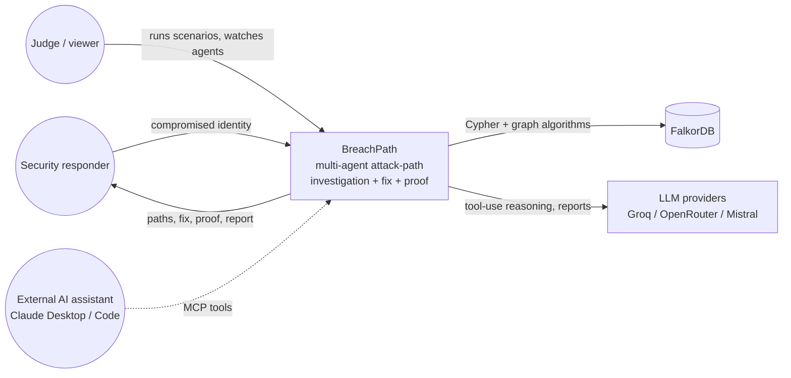

---

## 2. Container view

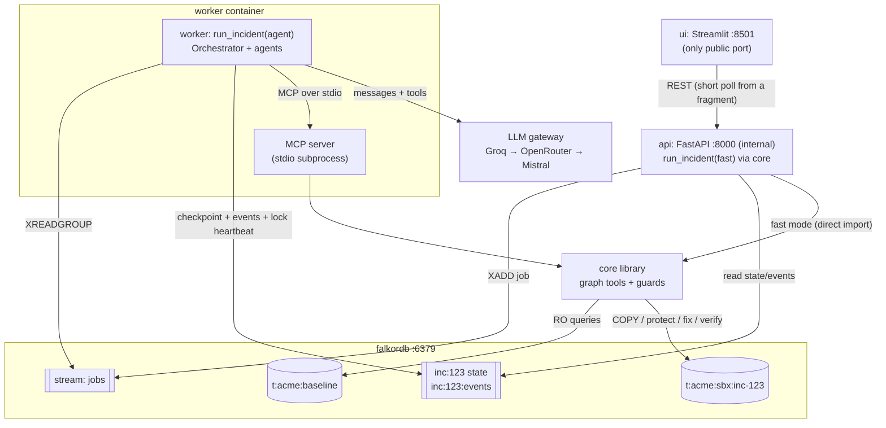

---

## 3. Agent mode, end to end

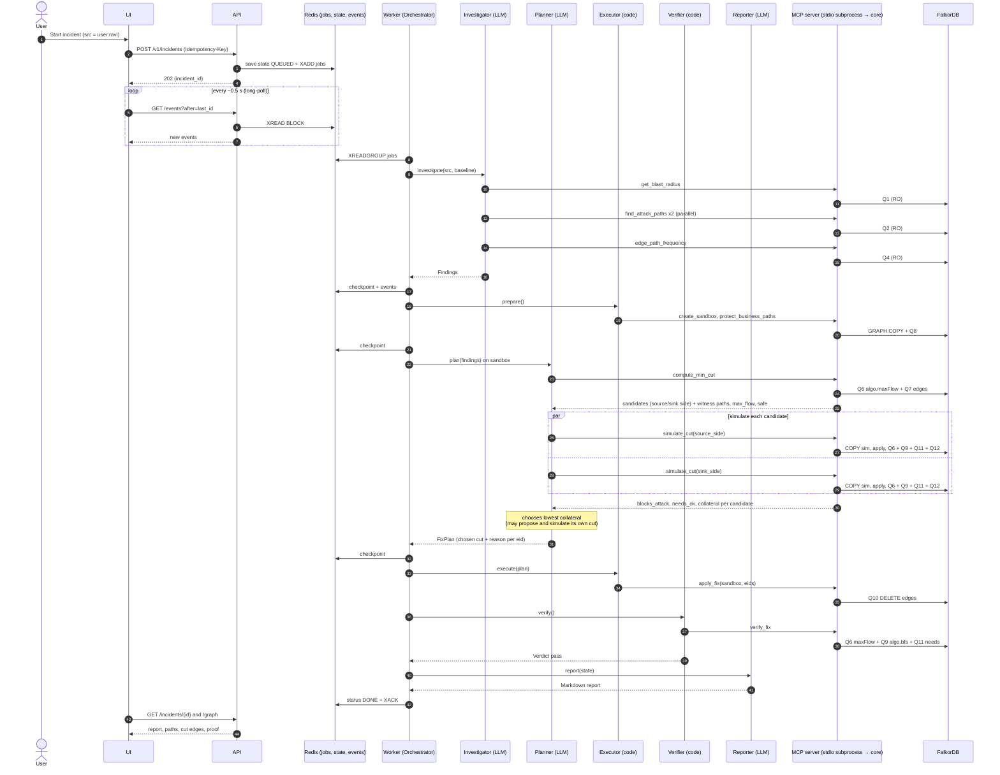

---

## 4. Fast mode (no LLM, about 1–2 s): the same `run_incident` pipeline, `mode=fast`

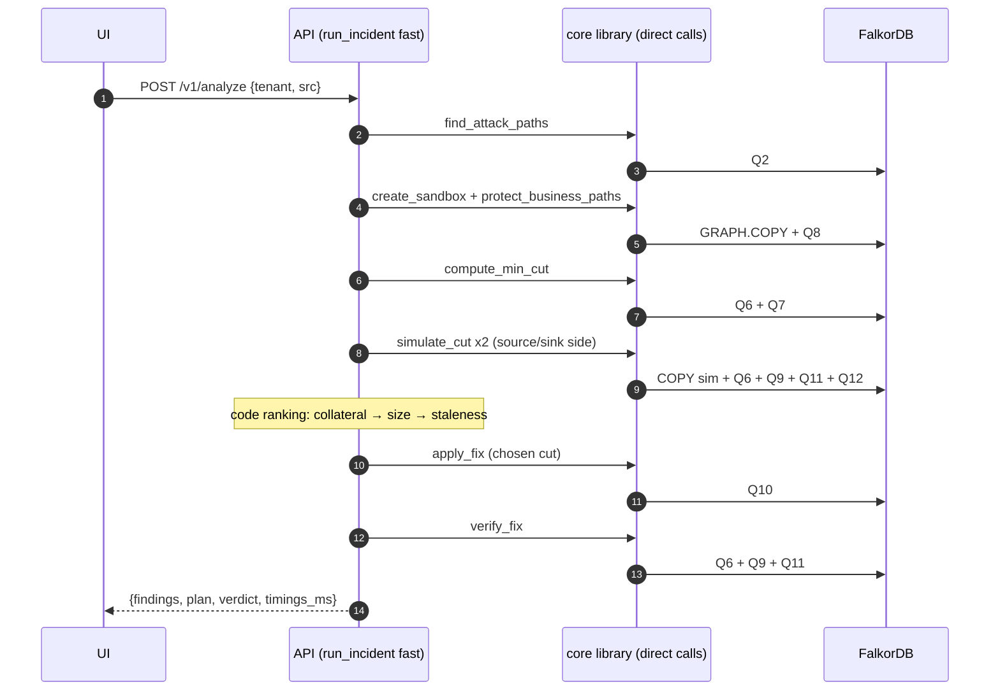

---

## 5. Incident state machine

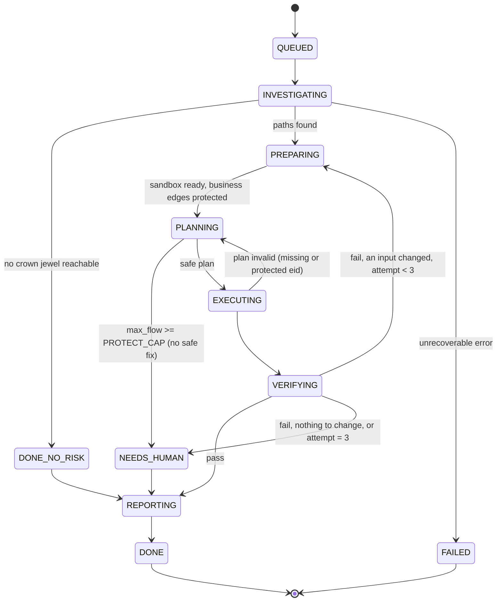

---

## 6. LLM agent tool loop (MCP)

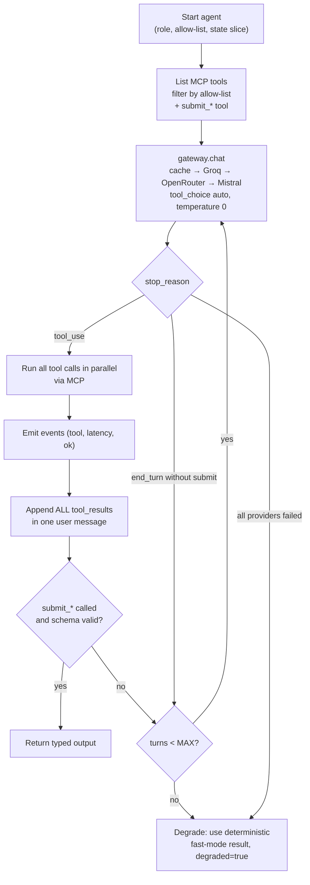

---

## 7. Min-cut computation

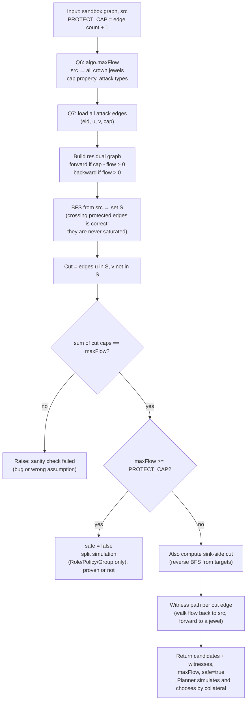

---

## 8. Fix → verify → retry loop

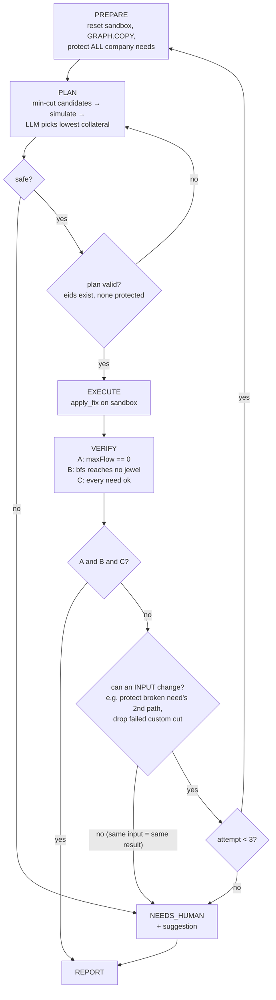

---

## 9. Example S2: before and after the fix

**Before:** 2 attack paths reach the crown jewels. **Business needs:** Ravi must still reach `server:staging` (deploys) and `server:build` (runs builds), so those path edges are protected (cap = PROTECT_CAP).

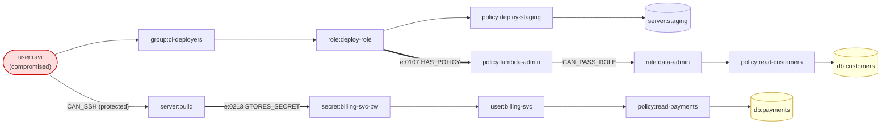

**After:** max flow was 2, so the min-cut removes 2 edges. The source-side residual search stops at the first saturated edge after the protected ones:
- `e:0107`: detach `policy:lambda-admin` from `role:deploy-role`, which removes the "create programs that run as other roles" right.
- `e:0213`: delete the saved `billing-svc` password from `server:build`.

Both business paths are untouched.

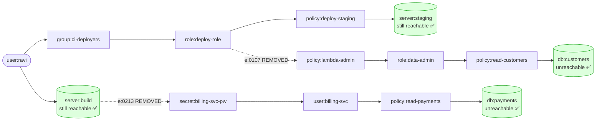

**Proof:** `maxFlow(ravi → jewels) = 0`, `algo.bfs` from ravi reaches no jewel, and every company-wide need is ok (including `ravi → staging` and `ravi → build`). **Collateral:** the report lists anyone else who lost access through `e:0107`/`e:0213` (in S2, nobody uses `policy:lambda-admin` via `deploy-role`, so collateral = 0; the generator asserts this).

> **Why business needs matter:** without the `ravi → build` need, the source-side cut would remove Ravi's SSH to `server:build` instead. That's also size 1, but it would block his builds. The capacities steer the min-cut away from edges people need.

---

## 10. Data generation and load

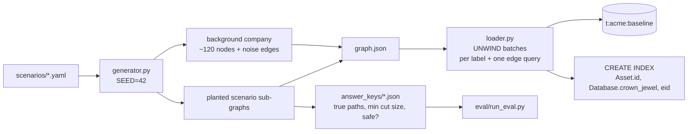

---

## 11. Failure and degradation paths

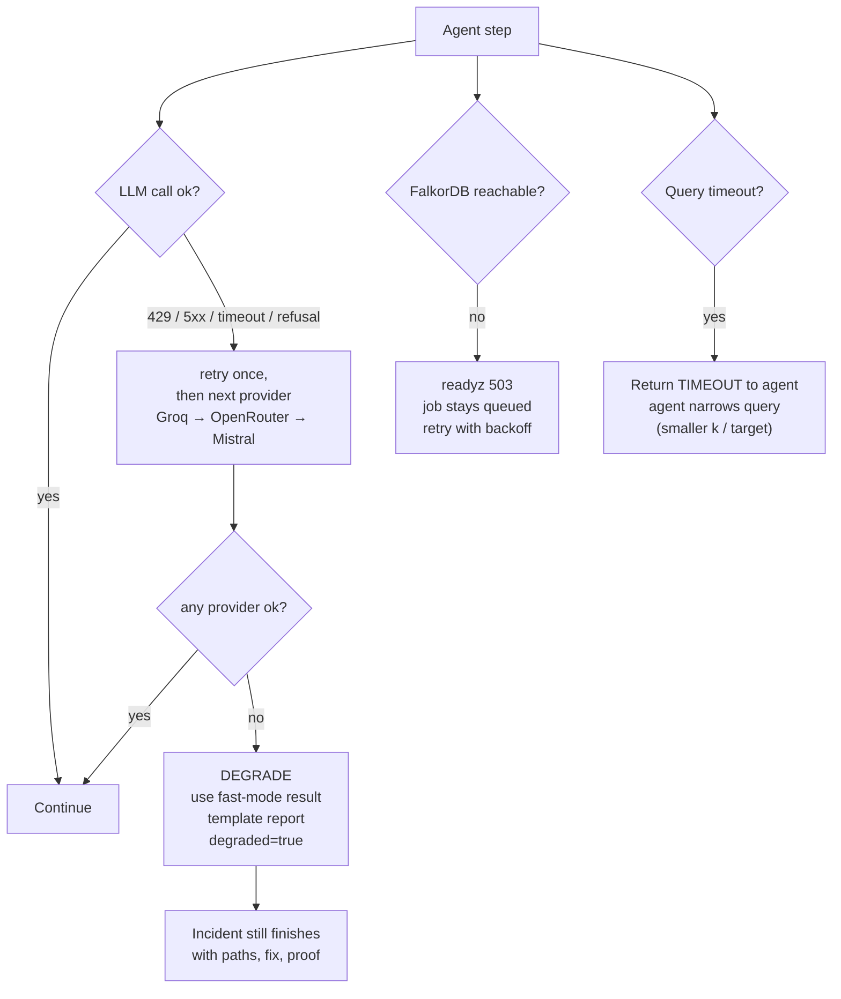

---

## 12. Worker crash recovery (scale path: **cut in v1**, single worker; the lock heartbeat is built)

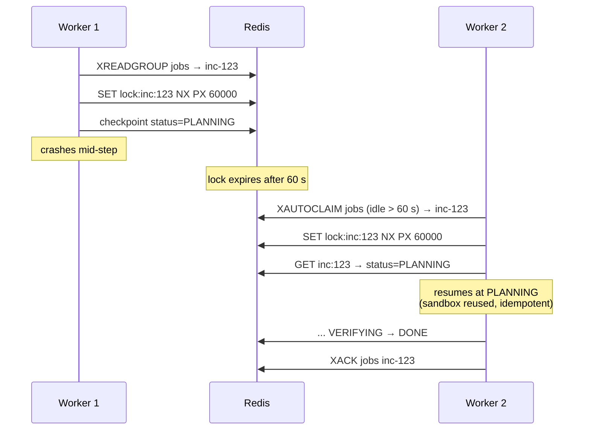

---

## 13. Evaluation pipeline

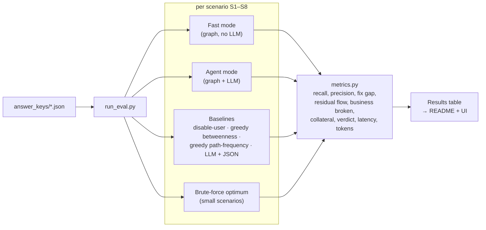
